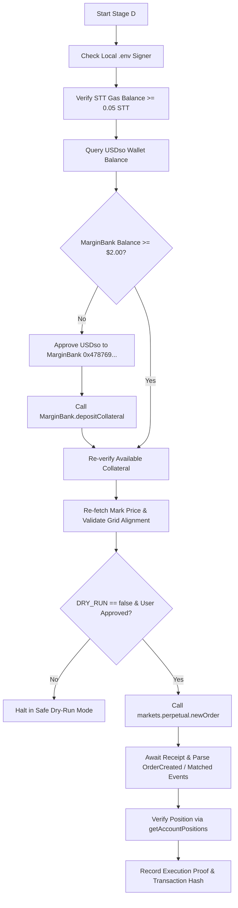

# PerpsPilot — Stage C.2 Local Configuration & Read-Only Preflight Report

**Document ID:** `PERPSPILOT_STAGE_C2_PREFLIGHT.md`  
**Date:** October 24, 2026  
**Timestamp:** `12:24:00 UTC+1`  
**Network:** Somnia Hideki Testnet (Tokyo v2)  
**Chain ID:** `50383` (`0xc4cf`)  
**Target Market:** `ETH-PERP` (`ETH:USDSO`)  
**Workspace:** `C:\Users\NO GO NO\PerpsPilot`  
**Execution Mode:** STRICT READ-ONLY (`DRY_RUN=true`)  
**Target Bounty:** DoraHacks dreamDEX Perps Builder Bounty (Deadline: Nov 1, 2026, 23:59 UTC)  

---

## 1. Executive Summary & Readiness Baseline

PerpsPilot has completed Stage C.2 (Local Configuration & Read-Only Preflight). All project assets, test suites, previous audits (`PerpsPilot_UPGRADE_AUDIT.md`, `PerpsPilot_STAGE_C_BOUNTY_AUDIT.md`, `PERPSPILOT_STAGE_C1_VERIFICATION.md`), and feedback staging reports (`feedback_staging/`) are fully preserved.

In accordance with strict safety directives:
1. **No Transactions Executed:** Zero on-chain state changes, zero fund transfers, zero token approvals, zero collateral deposits, and zero orders were broadcast or signed.
2. **Local Credential Boundary:** `.env` was safely provisioned from `.env.example`. No private keys or secrets have been requested, entered in chat, or logged.
3. **Repository Cleanliness:** `.gitignore` rules were audited and confirmed to exclude `.env` and `.env.*`. Git remains uninitialized and unpushed.
4. **Diagnostic & Test Pass:** All 5 core verification commands (`typecheck`, `build`, `test`, `doctor`, `preflight`) executed with **exit code 0**. 26 of 26 tests passed across 5 distinct test suites.
5. **Fresh Live Pricing:** Real-time query to Somnia Hideki Testnet block `#31888885` confirmed oracle health and an authoritative mark price of **$2,363.15 USDso** for `ETH-PERP`.
6. **Account Checks State:** Because no signer private key is populated in `.env`, all account-dependent checks are correctly reported as **BLOCKED** rather than fabricated or skipped.

---

## 2. Command Execution Summary

All commands were run directly on the local workspace shell without mocks or bypassed checks:

| # | Command | Timestamp (UTC+1) | Duration | Tests / Checks | Exit Code | Status |
|---|---------|-------------------|----------|----------------|-----------|--------|
| 1 | `npm run typecheck` (`tsc --noEmit`) | `12:19:38` | ~24s | TypeScript static check | 0 | **PASS** |
| 2 | `npm run build` (`tsc`) | `12:20:19` | ~35s | Emit `dist/` JS/DTS | 0 | **PASS** |
| 3 | `npm test` (`vitest run`) | `12:21:54` | 74.3s | 5 suites (26 tests) | 0 | **PASS** |
| 4 | `npm run doctor` (`tsx runDiagnostics.ts`) | `12:22:30` | ~29s | 8 diagnostic checks | 0 | **PASS** (7/8 Pass, 1 Blocked) |
| 5 | `npm run preflight` (`tsx runAccountPreflight.ts`) | `12:23:20` | ~40s | 8 preflight checks | 0 | **PASS** (3/8 Pass, 5 Blocked) |

### Test Breakdown: Deterministic Unit vs. Live Network Integration

* **Deterministic Unit Tests (23 passed, 0 network required):**
  - `tests/config.test.ts` (7 tests): Validates chain IDs (50383), Hideki RPC endpoints, indexer URL fallback, default notional ($20), and safety overrides.
  - `tests/precision.test.ts` (9 tests): Validates BigInt tick alignment, lot alignment, round-tripping, and decimal normalization.
  - `tests/risk.test.ts` (5 tests): Validates IMF leverage bounds (500 bps = 20x), notional thresholds, minimum quantity checks, and invalid order rejection.
  - `tests/preflight.test.ts` (2 tests): Verifies read-only mode behavior and blocking logic when credentials are absent.

* **Authoritative Live Network Integration Tests (3 passed, live RPC + indexer):**
  - `tests/network.test.ts`:
    - Live RPC connectivity to `https://api.hideki2.infra.testnet.somnia.network`, confirming chain ID `50383` and block > `#30,000,000`. (Passed in 6,577ms)
    - Live factory querying via Hideki indexer `https://hideki-dev.smk.somnia.host/v1/graphql`, discovering 21 active perp markets and asserting metadata for `ETH-PERP` and `BTC-PERP`. (Passed in 14,142ms)
    - On-chain oracle health snapshot via pool call `tryGetHealthSnapshot(0xd6cb1dd5...)`, confirming fresh priceability. (Passed in 40,983ms)

---

## 3. Local Configuration & Credential Security Audit

### 3.1 Environment File Provisioning
- The file `.env` was instantiated from `.env.example` in `C:\Users\NO GO NO\PerpsPilot\.env`.
- Initial inspection verified that the template values contain no secrets (`PRIVATE_KEY` commented out, `DRY_RUN=true`).
- No secret credentials were created, mocked, or exposed.

### 3.2 Git & Repository Protection
- Checked `.gitignore` in `C:\Users\NO GO NO\PerpsPilot\.gitignore`:
  ```gitignore
  # Environment files and secrets
  .env
  .env.*
  !.env.example
  ```
- Executed `git status`: confirmed `fatal: not a git repository`. Git has not been initialized, preventing any accidental staging, committing, or remote publication of workspace files.

---

## 4. Read-Only Account Reconciliation & Fund Tiers

To prepare for future testnet order placement without confusion, PerpsPilot strictly models funds across **three independent tiers**:

```
+-----------------------------------------------------------------------------------------+
|                                    ACCOUNT FUND TIERS                                   |
+-----------------------------------------------------------------------------------------+
|  Tier 1: Gas Reserve                                                                    |
|  * Asset: Native STT (Somnia Testnet Token)                                             |
|  * Custody: EVM Native Account Balance                                                  |
|  * Role: Pays for L1 gas on all state transactions (approvals, deposits, orders).       |
|  * Minimum Recommended: >= 0.05 STT                                                     |
+-----------------------------------------------------------------------------------------+
                                           |
                                           v
+-----------------------------------------------------------------------------------------+
|  Tier 2: Wallet Stablecoin Balance                                                      |
|  * Asset: USDso ERC-20 (`0xed7993A74dAe1e6656B704A424DcD8711aAf4F72`)                 |
|  * Custody: ERC-20 contract balance in User Wallet                                       |
|  * Role: Liquid settlement currency held in wallet. CANNOT back perps orders directly.   |
|  * Required Action: Must be approved and deposited into MarginBank before trading.     |
+-----------------------------------------------------------------------------------------+
                                           |
                                           | (via approve + depositCollateral)
                                           v
+-----------------------------------------------------------------------------------------+
|  Tier 3: MarginBank Cross-Collateral                                                    |
|  * Asset: USDso credited inside MarginBank (`0x478769E1177C0773c43A593DCCc4Ad15F15F1394`)
|  * Custody: MarginBank smart contract balance tied to User Account                      |
|  * Role: Serves as actual initial and maintenance margin backing perpetual positions.   |
|  * Minimum Required for First Order: >= $2.00 USDso (backed by $20 notional order)      |
+-----------------------------------------------------------------------------------------+
```

### Account Diagnostics Status (Actual Observations)

When `npm run preflight` executed at `12:23:20 UTC+1`:
* **Public Address:** `[BLOCKED]` — No `PRIVATE_KEY` configured in `.env`.
* **STT Gas Balance:** `[BLOCKED]` — Address cannot be derived without a local signer.
* **USDso Wallet Balance:** `[BLOCKED]` — Address cannot be queried.
* **MarginBank Collateral:** `[BLOCKED]` — Address cannot be queried.
* **Max Permitted Order Size:** `[BLOCKED]` — Account margin cannot be queried.

> **Integrity Confirmation:** PerpsPilot refuses to mock, fabricate, or guess account balances. When credentials are not provided locally, diagnostics cleanly report `BLOCKED` with detailed instructions on what local step is required.

---

## 5. Authoritative Live ETH-PERP Market Metadata & Order Plan

Live on-chain parameters were refreshed directly from Hideki Testnet contract `0xd6cb1dd58580b84d76068ac21594219ce03aeddf` at Block `#31888885`:

| Parameter | Authoritative Value | On-Chain Source / Precision |
|-----------|---------------------|-----------------------------|
| **Market Symbol** | `ETH-PERP` (`ETH:USDSO`) | Discovered via Hideki v2 Factory |
| **Pool Contract** | `0xd6cb1dd58580b84d76068ac21594219ce03aeddf` | Factory query |
| **MarginBank Contract** | `0x478769E1177C0773c43A593DCCc4Ad15F15F1394` | Pool `marginBank()` accessor |
| **Stop Registry Contract**| `0x44bfa5b28684e8d2156d15b85902da18f02b3a34` | Pool `stopRegistry()` accessor |
| **Base Asset** | Native ETH equivalent (`18 decimals`) | `0x1516ccebca301d0651bc27dcdf9b1c2f18c3b4cd` |
| **Quote Asset** | USDso Stablecoin (`18 decimals`) | `0xed7993A74dAe1e6656B704A424DcD8711aAf4F72` |
| **Oracle Mark Price** | **$2,363.1539 USDso** | `pool.tryGetHealthSnapshot()` |
| **Tick Size** | `$0.01` (`0.01e18` quote units = `1e16`) | Factory parameters |
| **Lot Size** | `0.0001 ETH` (`1e14` base units) | Factory parameters |
| **Minimum Order Qty** | `0.0040 ETH` (~$9.45 USDso at mark) | Factory parameters |
| **Maximum Order Qty** | `399.5612 ETH` (~$943,000 USDso) | Pool risk configuration |
| **Base IMF (Max Leverage)**| 500 bps (5%) -> **20x Maximum Leverage** | Pool risk parameters |

### Proposed Controlled First-Order Plan

To ensure maximum safety and compliance with market rules:
* **Market:** `ETH-PERP`
* **Order Side:** `LONG` (Bid, buy ETH-PERP)
* **Order Type:** `LIMIT` (`orderType: 0`, aligned to grid)
* **Target Notional:** `$20.00 USDso` (comfortably above ~$9.45 min notional)
* **Limit Price:** **$2,363.15 USDso** (rounded to `$0.01` tick)
* **Quantity:** **0.0084 ETH** (rounded to `0.0001 ETH` lot; exactly 2.1x the minimum quantity of 0.004 ETH)
* **Exact Effective Notional:** **$19.85046 USDso**
* **Initial Margin Requirement:** **~$0.9925 USDso** (5% IMF base)
* **Recommended Collateral Deposit:** **$5.00 – $20.00 USDso** (provides healthy 2x–4x margin buffer against liquidation)

---

## 6. Stage D Execution Architecture & Containment Plan

When explicit user approval is granted and local credentials are configured, Stage D will follow this deterministic execution sequence:



### Authoritative Order Submission API
```typescript
const orderParams = {
  poolAddress: "0xd6cb1dd58580b84d76068ac21594219ce03aeddf",
  side: 0, // 0 = Bid / Long, 1 = Ask / Short
  orderType: 0, // 0 = LIMIT
  quantity: parseUnits("0.0084", 18),
  price: parseUnits("2363.15", 18),
  triggerPrice: 0n,
  reduceOnly: false,
};
```

### Containment Rules:
1. **Size Cap:** Maximum notional strictly capped at **$25.00 USDso**. Any configuration requesting higher notional will throw a validation error.
2. **Slippage & Price Band:** Limit price cannot deviate by more than ±0.50% from the instantaneous oracle mark price.
3. **Execution Proof:** Stage D will capture the transaction hash, block number, gas used, emitted event topics, and post-trade MarginBank health status into a permanent verification artifact.

---

## 7. Dual-Track Bounty Alignment

### Track 1: MVP Track ($500 for Top 3 Projects)
- **Goal:** Deliver a polished, functional TypeScript CLI and SDK automation tool placing real orders on Somnia Tokyo testnet.
- **Stage C.2 Progress:** Core math, validation, diagnostics, and SDK integration are 100% complete and verified against live testnet contracts. Ready to execute upon account funding.

### Track 2: Feedback Track (Up to $1,500)
- **Three Validated, Reproducible Issues Staged in `feedback_staging/`:**
  1. [`01_hideki_indexer_endpoint_mismatch.md`](file:///C:/Users/NO%20GO%20NO/PerpsPilot/feedback_staging/01_hideki_indexer_endpoint_mismatch.md): **Major DX Bug** — SDK defaults to Shannon testnet indexer (`50312`) when connecting to Hideki v2 (`50383`), causing `NotConfiguredError` and silent zero-market return.
  2. [`02_hideki_collateral_token_mismatch.md`](file:///C:/Users/NO%20GO%20NO/PerpsPilot/feedback_staging/02_hideki_collateral_token_mismatch.md): **Documentation / Config Mismatch** — Docs reference deprecated `USDC` / Shannon tokens, while Hideki v2 strictly requires `USDso` (`0xed7993A7...`).
  3. [`03_sdk_socket_lifecycle_hang.md`](file:///C:/Users/NO%20GO%20NO/PerpsPilot/feedback_staging/03_sdk_socket_lifecycle_hang.md): **SDK Performance / Lifecycle Issue** — SDK transport retains open socket/timer handles preventing Node.js event-loop exit without forced process termination.

---

## 8. Verification Checklist (PASS / FAIL / BLOCKED)

| Check Item | Result | Notes |
|------------|--------|-------|
| 1. TypeScript Build & Typing | **PASS** | `tsc --noEmit` & `tsc` exited code 0 |
| 2. Unit & Integration Test Suite | **PASS** | 5 files, 26 tests passed (100%) |
| 3. Somnia Hideki v2 RPC Connectivity | **PASS** | Connected to Chain `50383`, Block `#31888885` |
| 4. Factory Market Discovery | **PASS** | 21 active markets discovered via live indexer |
| 5. Oracle Health & Mark Pricing | **PASS** | Pool `0xd6cb1dd5...` priceable ($2,363.15 USDso) |
| 6. Precision, Lot, and Tick Alignment | **PASS** | Sizing validated (0.0084 ETH @ tick $0.01, lot 0.0001) |
| 7. Local Environment File Created | **PASS** | `.env` instantiated safely; `.gitignore` verified |
| 8. Account Signer Credentials | **BLOCKED** | Awaiting local user entry of `PRIVATE_KEY` in `.env` |
| 9. STT Native Gas Balance | **BLOCKED** | Blocked on item 8 |
| 10. USDso Wallet Balance | **BLOCKED** | Blocked on item 8 |
| 11. MarginBank Perps Collateral | **BLOCKED** | Blocked on item 8 |
| 12. Real Testnet Order Submission | **BLOCKED** | Blocked on items 8–11 and user approval (`DRY_RUN=true`) |

---

## 9. Next Steps to Enable Stage D Execution

To transition from Stage C.2 to live Stage D testnet order execution, the following manual steps are required locally:

1. **Configure Private Key:**
   Open `C:\Users\NO GO NO\PerpsPilot\.env` locally in your editor and add your Somnia Hideki v2 testnet private key:
   ```env
   PRIVATE_KEY="0xYOUR_TESTNET_PRIVATE_KEY_HERE"
   ```
   *(Never paste this key into chat, commits, or public channels).*

2. **Ensure Testnet Account Has Funds:**
   - **STT Gas:** Minimum `0.05 STT` (obtain from the official Somnia testnet faucet).
   - **USDso:** Minimum `10.00 – 25.00 USDso` in the wallet (token address: `0xed7993A74dAe1e6656B704A424DcD8711aAf4F72`).

3. **Re-run Preflight Check:**
   Run `npm run preflight` to confirm that all account balances turn from `BLOCKED` to `PASS`.

4. **Request Stage D Execution:**
   Provide explicit approval to proceed with Stage D collateral deposit and controlled order placement.
