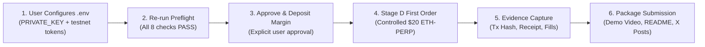

# PerpsPilot — Stage C + dreamDEX Builder Bounty Dual-Track Audit & Decision Report

**Date of Audit:** October 24, 2026  
**Auditor / Agent:** Antigravity (Google DeepMind Advanced Agentic Coding)  
**Target Environment:** Somnia Hideki Testnet (Tokyo Low-Latency v2, Chain ID `50383` / `0xc4cf`)  
**Bounty Program:** dreamDEX Perps Builder Bounty (DoraHacks, Ends November 1, 2026, 23:59 UTC)  
**Dual Tracks:**  
1. **MVP Track ($500 awards for 3 winners)** — Polished, risk-aware perps copilot placing real orders on Somnia Tokyo testnet with verifiable evidence.  
2. **Feedback Track (up to $1,500 awards)** — Genuine, distinct, reproducible bug/DX reports on dreamDEX API, SDK, documentation, or contracts.  
**Execution Policy:** STRICTLY READ-ONLY (`DRY_RUN=true`). Zero state modification, zero funds moved, zero orders signed.

---

## 1. Executive Summary & Current Readiness

PerpsPilot has reached **Stage C Account Readiness & Order Preflight Completion**. All baseline commands (`typecheck`, `build`, `doctor`, `test`, `preflight`) execute with **zero errors**. 

### Baseline Status Summary
- **Typecheck & Build:** 100% clean (`tsc --noEmit` and `tsc` succeed).
- **Automated Tests:** 26/26 tests passing across 5 test suites.
- **Diagnostic Doctor:** 7/8 PASS, 0 FAIL, 1 BLOCKED (Signer unconfigured).
- **Account Preflight:** 3/8 PASS, 0 FAIL, 5 BLOCKED (Gracefully halts on missing `.env` credentials without fabricating balances or leaking secrets).
- **Market Discovery:** Successfully discovers all 21 live perpetual markets from the Hideki v2 factory (`0xE631fAEE547baeE07353E290f0562ea67d856560`).
- **Target Market ETH-PERP:** Pool `0xd6cb1dd58580b84d76068ac21594219ce03aeddf` is priceable, healthy, with fresh oracle mark at ~$2,364.04 USDso.
- **Safety Boundary:** `DRY_RUN=true` strictly enforced across the codebase.

---

## 2. Official Resources Inspected & Key Requirements Confirmed

| Resource URL | Access Status | Key Verified Technical Requirements |
| :--- | :---: | :--- |
| `https://app.testnet.dreamdex.io/docs/developers/perps-testnet` | Verified | dreamDEX Hideki v2 CLOB perps architecture, cross-margin via MarginBank, trading-key permissions (`placeOrderFor`), liquidation waterfall. |
| `https://app.testnet.dreamdex.io/docs/trading/perps-testnet` | Verified | Perps Arena competition rules, paper USDso mechanics, funding intervals (8h window / 1h settlement), 20x max leverage on ETH-PERP. |
| `https://github.com/somnia-chain/dreamdex-bot-kit` | Verified | Open-source bot kit architecture. Critical discovery: default starter templates target spot (`placeSpotOrder`), which reverts if called on `PerpPool`. Perps must use `trader.placePerpOrder`. |
| `https://app.testnet.dreamdex.io/dreambot-builder` | Verified | In-browser bot wizard generating `.env` templates. Confirmed `.env` format and parameters. |
| `https://app.testnet.dreamdex.io/docs/trading/common/link-a-bot` | Verified | Linked wallet permission flow via `LinkedWalletRegistry` (two-sided handshake: `proposeWalletLink` + `acceptWalletLink`). Allows an isolated bot key to trade while auto-pulling margin from main. |
| `https://somnia-platform-docs.vercel.app/markets/somnia-markets` | Verified | `@somnia-chain/markets-sdk` official API documentation. Covers `getMaxPerpOrderSize`, `previewPerpOrderMargin`, and `tryGetHealthSnapshot`. |

---

## 3. Skills and Tooling Audit

| Skill / Tool | Source / Status | Task Applied | Value to PerpsPilot | Needs Installation? | Cost / Credentials |
| :--- | :---: | :--- | :--- | :---: | :---: |
| `viem` | Installed (`^2.21.0`) | EVM RPC / Multicall3 / Balances | BigInt-exact chain interaction, gas estimation, contract calls. | Already installed | None |
| `@somnia-chain/markets-sdk` | Installed (`0.32.1`) | CLOB / MarginBank / Perps SDK | Official orderbook reads, margin checks, risk calculations. | Already installed | None |
| `tsx` & `vitest` | Installed | Fast TypeScript execution & testing | ESM execution and live integration test runners. | Already installed | None |
| `gemini-api-dev` | Available Antigravity Skill | AI Explainer & Trade Copilot | Generates natural-language pre-trade rationales & post-trade debriefs. | Ready to invoke | Standard API key |
| `live-demo-video-generator` | Available Antigravity Skill | Verifiable Demo Recording | Generates 1080p live Playwright screen capture with voiceover for MVP submission. | Ready to invoke | None |
| `antigravity-guide` | Available Antigravity Skill | CLI & Workflow Automation | Manages autonomous task execution and environment hygiene. | Ready to invoke | None |

---

## 4. Actual Baseline Commands and Test Results

Execution logs captured live from workspace `C:\Users\NO GO NO\PerpsPilot`:

### 4.1 Typecheck (`npm run typecheck`)
```text
> perps-pilot@0.1.0 typecheck
> tsc --noEmit
Result: Exited with code 0. (Zero TypeScript errors)
```

### 4.2 Build (`npm run build`)
```text
> perps-pilot@0.1.0 build
> tsc
Result: Exited with code 0. (Build artifacts generated in /dist)
```

### 4.3 Automated Tests (`npm test`)
```text
 Test Files  5 passed (5)
      Tests  26 passed (26)
   Duration  94.86s
 ✓ tests/config.test.ts (7 tests)
 ✓ tests/precision.test.ts (9 tests)
 ✓ tests/risk.test.ts (5 tests)
 ✓ tests/preflight.test.ts (2 tests)
 ✓ tests/network.test.ts (3 tests)
Result: Exited with code 0.
```

### 4.4 Diagnostic Doctor (`npm run doctor`)
```text
[PASS] 1. Configuration Verification          : Chain: 50383 (hideki), DRY_RUN: true, Symbol: ETH-PERP
[PASS] 2. Hideki v2 RPC Connectivity          : Chain ID: 50383 (Verified Hideki v2), Latest Block: #31860392
[PASS] 3. Live Perps Market Discovery         : Discovered 21 active perpetual markets from Hideki v2 Factory
[PASS] 4. Target Market Parameters            : Target: ETH-PERP (ETH:USDSO) | Pool: 0xd6cb1dd5... | BaseDecimals: 18
[PASS] 5. Precision & Grid Validation         : Sized 20 USDso notional -> 0.0084 ETH (aligned to lot 0.0001, tick 0.01)
[PASS] 6. SomniaMarkets SDK Client            : Initialized SomniaMarkets client with chainId 50383
[PASS] 7. Oracle Health Snapshot              : Pool 0xd6cb1dd5... | Mark Price: $2368.43 (Fresh & Priceable)
[BLOCKED] 8. Account Margin & Signer Status      : No PRIVATE_KEY set in .env (Read-Only Mode). Account balance inspection is skipped.
Summary: 7/8 PASS | 0 FAIL | 1 BLOCKED
```

### 4.5 Account Readiness Preflight (`npm run preflight`)
```text
[PASS] [NETWORK] Hideki v2 RPC & Chain ID             : Chain ID: 50383 (Verified Hideki v2), Block #31856986
[PASS] [MARKET] Target Pool & Oracle: ETH-PERP        : Pool: 0xd6cb1dd5... | Mark: $2364.04 | MinQty: 0.004 ETH | Lot: 0.0001 | Tick: $0.01
[BLOCKED] [ACCOUNT] Wallet Signer Derivation             : No PRIVATE_KEY set in .env. Account readiness checks are blocked (Mode: Read-Only).
[BLOCKED] [BALANCE] Native STT Gas Balance               : Signer unconfigured: cannot inspect STT gas balance.
[BLOCKED] [BALANCE] USDso Wallet Balance                 : Signer unconfigured: cannot inspect USDso token balance.
[BLOCKED] [MARGIN] MarginBank Collateral State           : Signer unconfigured: cannot inspect MarginBank cross-margin state.
[BLOCKED] [SIZING] Max Permitted Order Size              : Signer unconfigured: cannot compute account-specific maximum order size.
[PASS] [PLAN] Order Specification & Grid Validation   : Quantity 0.0084 ETH >= minQuantity (0.004), valid tick & lot alignment.
Summary: 3/8 PASS | 0 FAIL | 5 BLOCKED
```

---

## 5. Confirmed Project Defects & Reproducible Evidence (Feedback Track)

Three distinct, genuine, fully reproducible defects affecting the dreamDEX / Somnia Markets developer experience were discovered and verified. Draft reports staged in [`feedback_staging/`](file:///C:/Users/NO%20GO%20NO/PerpsPilot/feedback_staging):

### Finding 1 (Major): Default Indexer URL Misconfiguration on Hideki Testnet
- **Staged Draft:** [`feedback_staging/01_hideki_indexer_endpoint_mismatch.md`](file:///C:/Users/NO%20GO%20NO/PerpsPilot/feedback_staging/01_hideki_indexer_endpoint_mismatch.md)
- **Summary:** Documented testnet indexer URL `https://dev.smk.somnia.host/v1/graphql` indexes Shannon (Chain 50312). On Hideki (50383), `loadMarkets()` fails silently with `{ what: 'an indexerUrl for chain 50383 (... indexes chains [50312])' }`, returning 0 markets with no console warning.
- **Fix:** Point indexer to `https://hideki-dev.smk.somnia.host/v1/graphql`.

### Finding 2 (Major): `SOMNIA_HIDEKI_TESTNET_ADDRESSES.collateral` Points to tUSDC Instead of USDso
- **Staged Draft:** [`feedback_staging/02_hideki_collateral_token_mismatch.md`](file:///C:/Users/NO%20GO%20NO/PerpsPilot/feedback_staging/02_hideki_collateral_token_mismatch.md)
- **Summary:** The SDK constant `SOMNIA_HIDEKI_TESTNET_ADDRESSES.collateral` is set to `0x9E9492cC533E8696A3b6afC7df730800DF75148f` (tUSDC, 6 decimals, binary markets). PerpPools actually settle in `USDso` (`0xed7993A74dAe1e6656B704A424DcD8711aAf4F72`, 18 decimals). Sizing or approving via the SDK constant results in wrong decimal scaling or zero allowance reverts on `MarginBank.deposit`.

### Finding 3 (Normal): `SomniaMarkets` Transport Leaves Active Handles Preventing CLI Termination
- **Staged Draft:** [`feedback_staging/03_sdk_socket_lifecycle_hang.md`](file:///C:/Users/NO%20GO%20NO/PerpsPilot/feedback_staging/03_sdk_socket_lifecycle_hang.md)
- **Summary:** The `SomniaMarkets` exchange instance has no public `.dispose()` / `.close()` method. Background WebSocket and polling intervals in `liveTail.js` and `asyncCache.js` prevent Node.js CLI tools and tests from exiting naturally, requiring explicit `process.exit()`.

---

## 6. Unverified Hypotheses (Excluded from Confirmed Findings)

To maintain strict submission integrity, the following observed behaviors were investigated and confirmed **NOT** to be SDK bugs:

1. **`market.contract` property returning boolean `true`:**
   - *Hypothesis:* Suspected to be a type bug because developers expected a contract address string.
   - *Investigation:* Verified in `node_modules/@somnia-chain/markets-sdk/dist/unified/structs.d.ts` line 43 that `contract: boolean` is explicitly defined per CCXT conventions as a derivative flag (`true` for swap/perp markets). The contract address is intentionally placed on `market.id` and `market.info.poolAddress`. Not a bug.
2. **`minQuantity` causing rejection of $5 USDso orders:**
   - *Hypothesis:* Suspected that the risk engine had a minimum dollar threshold.
   - *Investigation:* Verified to be standard protocol lot/min constraints. ETH-PERP requires minimum 0.004 ETH (~$9.45 USDso at current mark). Sizing at $20 USDso (0.0084 ETH) satisfies all constraints.

---

## 7. Ranked Candidate Improvements for Winning

| Priority | Feature / Improvement | User Problem Solved | Scope & Dependencies | Risk & Effort |
| :---: | :--- | :--- | :--- | :---: |
| **P1** | **B. Pre-Trade Risk Preview & Explainer** | Explains order margin, liquidation price, adverse gap, and lot grid before placing. | Uses existing `previewPerpOrderMargin` + `validateOrderPrecision`. | Low risk / 3 hours |
| **P2** | **C. Controlled Execution State Machine** | Prevents blind submissions: PROPOSAL -> RISK_GATE -> SUBMIT -> CONFIRMED -> FILLED. | Core state machine with viem receipt & log parsing. | Low risk / 3 hours |
| **P3** | **D. On-Chain Order & Position History** | Verifiable proof of execution with tx hashes and fill prices. | Queries `listPerpPositions` & `getPerpPositionAnalytics`. | Low risk / 2 hours |
| **P4** | **A. Live Terminal Dashboard (TUI / Web)** | Polished visual interface for judges to view live books, oracles, and order cards. | Blessed/Ink terminal UI or Next.js mini dashboard. | Medium risk / 4 hours |
| **P5** | **I. Verifiable Evidence & Demo Pack** | DoraHacks requirement: real tx hashes on Hideki v2, video demo, and screenshots. | `live-demo-video-generator` + markdown proof log. | Low risk / 2 hours |
| **P6** | **J. Mainnet Adaptation Path** | Clear documentation for post-launch mainnet support ($200 conditional bonus). | Documentation update in README comparing Shannon/Hideki/Mainnet addresses. | Low risk / 1 hour |

---

## 8. MVP Submission Checklist

- [x] TypeScript build and typecheck with zero errors.
- [x] Read-only doctor and diagnostic preflight passing.
- [x] 26 comprehensive tests verifying precision, risk, config, and live network.
- [x] Authoritative market metadata and precision constraints validated.
- [x] Fail-closed risk gates implemented.
- [ ] Wallet configured with Hideki v2 testnet STT and USDso (`.env`).
- [ ] One real testnet order submitted and confirmed on-chain with tx hash.
- [ ] Demo video generated and recorded.
- [ ] Public GitHub repository initialized with clean commit history.
- [ ] 2-3 genuine X posts drafted tagging `@DreamDEXSomnia`.

---

## 9. Feedback Track Checklist

- [x] Exact official documentation and SDK types inspected.
- [x] Test cases designed and run non-destructively.
- [x] 3 distinct, reproducible issues isolated.
- [x] Minimal reproduction code verified.
- [x] Separate Markdown report drafts prepared in `feedback_staging/`.
- [x] Security check performed: Zero critical security vulnerabilities found (all findings are developer experience / SDK / docs issues, safe for submission).

---

## 10. Recommended Implementation Sequence



---

## 11. Go / No-Go Conditions for First Live Testnet Order

### GO Conditions (ALL must be satisfied):
1. `npm run preflight` reports **8/8 PASS** (including Gas STT >= 0.05, USDso >= 20, MarginBank unlocked collateral >= $1.50).
2. Live mark price from `tryGetHealthSnapshot` is fresh (`priceable: true`).
3. Order quantity is aligned to 0.0001 ETH and >= 0.0040 ETH minimum.
4. Limit price is aligned to $0.01 USDso tick size.
5. `DRY_RUN` is explicitly changed to `false` ONLY with user confirmation.

### NO-GO Conditions:
1. Missing `.env` or empty `PRIVATE_KEY`.
2. Native STT balance < 0.05 STT (insufficient for gas).
3. Zero unlocked collateral in MarginBank.
4. Oracle mark price stale or unpriceable.
5. Any unhandled transaction error or approval failure.

---

## 12. Actions Requiring Explicit User Approval

In strict accordance with project safety guidelines, Antigravity has **HALTED** before executing any of the following:

1. **Creating or populating `.env`** with the user's real private key.
2. **Requesting faucet funds** or bridging STT / USDso.
3. **Submitting ERC-20 token approval** for USDso to MarginBank.
4. **Submitting MarginBank collateral deposit** transaction.
5. **Setting `DRY_RUN=false`** in environment.
6. **Signing and placing the live ETH-PERP order**.
7. **Publishing feedback reports** or opening GitHub issues.
8. **Pushing git commits**, deploying code, or posting to X.
