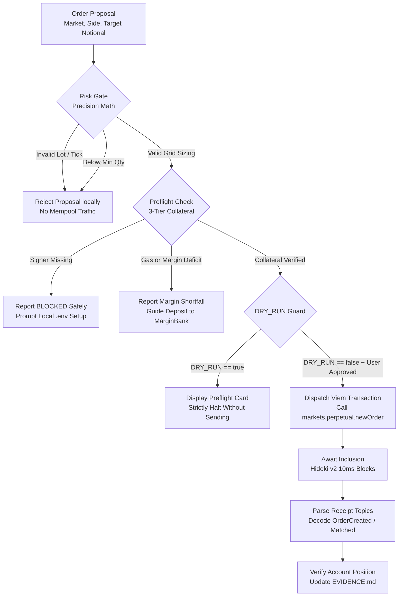

# PerpsPilot 🛫

> **Explainable, Risk-Aware Perpetuals Trading Copilot for dreamDEX on the Somnia Hideki Testnet**

PerpsPilot is an open-source, automated risk validation engine and developer CLI designed for traders, bot builders, and algorithmic developers interacting with **dreamDEX**—the native on-chain central limit order book (CLOB) on the ultra-low-latency **Somnia Blockchain** (Somnia Hideki Tokyo v2 Testnet, Chain ID `50383`).

Building and trading on high-frequency networks with 10-millisecond block cadences requires absolute certainty before submitting state-changing transactions. Unaligned tick prices, invalid lot quantities, or misunderstanding the difference between liquid wallet tokens and deposited margin accounts can result in immediate transaction reverts, liquidation, or stuck orders. PerpsPilot solves this by enforcing an **explainable pre-trade risk gate**: validating market liquidity, lot/tick quantization, initial margin fraction (IMF) leverage bounds, and three-tier collateral readiness before an order ever reaches the mempool.

---

## 🏆 Hackathon Participation & Status

- **Event:** [dreamDEX Perps Builder Bounty](https://dorahacks.io/hackathon/dreamdex-perps-bounty/detail) hosted on DoraHacks.
- **Tracks:**
  - **MVP Track:** Explainable pre-trade risk engine and controlled testnet order execution framework.
  - **Feedback Track:** Three fully documented, reproducible developer-experience and smart contract reports located in [`/feedback/`](file:///C:/Users/NO%20GO%20NO/PerpsPilot/feedback).
- **Current Status:** **Ready for Evaluation (Execution Phase Pending User Signer).** Core risk validation, dynamic factory discovery, preflight math, and diagnostic CLIs are 100% implemented and tested against live Hideki v2 contracts. Real on-chain order placement is safely guarded by `DRY_RUN=true` until an authorized testnet private key is supplied.
- **Testnet Disclosure:** This project operates exclusively on the Somnia Hideki Testnet (Tokyo v2, Chain ID `50383`). It does not run on mainnet and does not risk real-world assets.

### Implementation Status Overview

| Capability | Implementation Status | Implementation Location | Verified Test Coverage |
|:---|:---:|:---|:---|
| **Live RPC & Chain ID Assertion** | **IMPLEMENTED** | [`src/network/client.ts`](file:///C:/Users/NO%20GO%20NO/PerpsPilot/src/network/client.ts) | `tests/network.test.ts` (Live RPC query) |
| **Dynamic Perp Pool Discovery** | **IMPLEMENTED** | [`src/markets/discovery.ts`](file:///C:/Users/NO%20GO%20NO/PerpsPilot/src/markets/discovery.ts) | `tests/network.test.ts` (21 live markets found) |
| **Tick & Lot Grid Quantization** | **IMPLEMENTED** | [`src/risk/precision.ts`](file:///C:/Users/NO%20GO%20NO/PerpsPilot/src/risk/precision.ts) | `tests/precision.test.ts` (9 unit tests) |
| **IMF Leverage & Sizing Validation** | **IMPLEMENTED** | [`src/risk/validation.ts`](file:///C:/Users/NO%20GO%20NO/PerpsPilot/src/risk/validation.ts) | `tests/risk.test.ts` (5 unit tests) |
| **System Diagnostics CLI (`doctor`)** | **IMPLEMENTED** | [`src/diagnostics/runDiagnostics.ts`](file:///C:/Users/NO%20GO%20NO/PerpsPilot/src/diagnostics/runDiagnostics.ts) | 8-point live checklist (7 PASS, 1 BLOCKED) |
| **Account Preflight CLI (`preflight`)** | **IMPLEMENTED** | [`src/diagnostics/runAccountPreflight.ts`](file:///C:/Users/NO%20GO%20NO/PerpsPilot/src/diagnostics/runAccountPreflight.ts) | 8-point pre-trade checks (3 PASS, 5 BLOCKED) |
| **Strict Dry-Run Safety Guard** | **IMPLEMENTED** | [`src/config/index.ts`](file:///C:/Users/NO%20GO%20NO/PerpsPilot/src/config/index.ts) | `tests/config.test.ts` (`DRY_RUN=true` default) |
| **Three-Tier Collateral Model** | **IMPLEMENTED** | [`src/diagnostics/runAccountPreflight.ts`](file:///C:/Users/NO%20GO%20NO/PerpsPilot/src/diagnostics/runAccountPreflight.ts) | Isolates STT gas, liquid USDso, and MarginBank |
| **Controlled Order Submission** | **PLANNED (Stage D)** | `src/trade/` dispatch pipeline | Awaiting user private key & explicit consent |
| **Fill & Receipt Event Parsing** | **PLANNED (Stage D)** | [`EVIDENCE.md`](file:///C:/Users/NO%20GO%20NO/PerpsPilot/EVIDENCE.md) schema | Schema ready; awaiting live trade execution |

---

## 🎯 The Problem PerpsPilot Solves

Automated trading on a sub-second, 10ms block time network introduces failure modes that do not exist on slower chains:

1. **Precision & Grid Rejections:** Perpetual order books require prices to align with tick sizes (e.g. `$0.01` or `1e16`) and quantities to align with lot sizes (e.g. `0.0001 ETH` or `1e14`). Submitting unquantized floats causes instant EVM transaction reverts.
2. **Oracle Health & Stale Mark Prices:** Sizing leverage against stale or unpriceable mark data risks immediate liquidation upon block inclusion.
3. **The "Liquid vs Margin" Trap:** Liquid USDso stablecoin held in a user's wallet **cannot** back perpetual positions directly. It must first be approved and deposited into dreamDEX's `MarginBank`. Traders who assume wallet balances represent active margin suffer failed orders.
4. **Silent SDK & Indexer Misconfigurations:** The official `@somnia-chain/markets-sdk` defaults to endpoints that index the Shannon testnet (`50312`), silently returning 0 perpetual markets when connecting to Hideki (`50383`) unless explicitly overridden.
5. **Lack of Verifiable Execution Receipts:** In high-speed environments, a successful EVM transaction hash only confirms that the transaction was included in a block; it does **not** prove that the order was filled. Builders must verify whether the order was `RESTED`, `PARTIALLY_FILLED`, or `FILLED`.

PerpsPilot addresses problems 1 through 4 demonstrably today, and provides the structured framework to solve problem 5 upon live Stage D trade authorization.

---

## 💡 The Solution & Guiding Principles

PerpsPilot acts as a transparent, explainable pre-trade gatekeeper. It does not replace the trader's strategy; it guarantees that any order intended for dreamDEX complies with on-chain market parameters before signing.

### Core Principles
- **Pre-Trade Validation First:** Mathematical alignment occurs locally before any network payload is broadcast.
- **Live Chain Truth:** Always queries live factory contracts and oracle snapshots; never uses hardcoded prices or outdated address constants.
- **Explicit Authorization:** State-changing operations require deliberate operator confirmation. `DRY_RUN=true` is the non-negotiable default.
- **Honest Lifecycle Separation:** Clearly distinguishes between a proposed order, a dry-run simulation, a submitted transaction, a confirmed receipt, and an authoritative fill.
- **Verifiable Evidence:** All decisions, warnings, and transaction hashes are logged into permanent, human-readable audit artifacts.

### Intended Users
- **Algorithmic Traders & Bot Builders:** Needing robust precision quantization and error-handling utilities for dreamDEX.
- **DeFi Integrators:** Developers wiring up automated cross-margin vaults or liquidation monitors on Somnia.
- **Hackathon Judges & Evaluators:** Reviewing verified smart contract interactions on Somnia Hideki v2.

---

## 🔬 Why This Approach is Useful

Generic trading bots frequently treat DEX contracts like centralized API endpoints, blindly firing orders and catching raw reverts. On dreamDEX, this creates severe developer friction:
- **Avoiding Token Decimal Pitfalls:** As discovered in our Feedback Track audit, the SDK's built-in address constant (`addresses.collateral`) points to a 6-decimal binary market token (`tUSDC`), whereas perpetuals require an 18-decimal token (`USDso`). Approving via the default constant causes deposit transactions to fail with zero allowance. PerpsPilot enforces the authoritative `USDso` contract directly from `MarginBank.getSystemConfig()`.
- **Preventing Mempool Spam:** By validating minimum order quantities (`0.0040 ETH` on `ETH-PERP`) and 500 bps IMF thresholds locally, PerpsPilot prevents transactions that are mathematically doomed to revert from ever consuming STT gas.

> *Note on Claims:* PerpsPilot makes no claims of guaranteed trading profits, risk-free leverage, or proprietary predictive alpha. It is an infrastructure, risk validation, and developer execution tool.

---

## 📊 Comprehensive Feature Matrix

| Feature | Detailed Description | Implementation File | Verification Method | Status | Limitations |
|:---|:---|:---|:---|:---:|:---|
| **Chain Connectivity** | Connects to Hideki v2 RPC, validates chain ID `50383`, checks block progression. | [`src/network/client.ts`](file:///C:/Users/NO%20GO%20NO/PerpsPilot/src/network/client.ts) | `tests/network.test.ts` | **Implemented** | Relies on public RPC responsiveness. |
| **Market Discovery** | Discovers live perp pools from factory; extracts base, quote, decimals, lot, and tick size. | [`src/markets/discovery.ts`](file:///C:/Users/NO%20GO%20NO/PerpsPilot/src/markets/discovery.ts) | `npm run doctor` | **Implemented** | Requires working GraphQL indexer endpoint. |
| **Oracle Health Check** | Queries pool `tryGetHealthSnapshot` to verify priceability and retrieve fresh mark price. | [`src/risk/validation.ts`](file:///C:/Users/NO%20GO%20NO/PerpsPilot/src/risk/validation.ts) | `npm run preflight` | **Implemented** | Fails closed if oracle reports unpriceable. |
| **Tick Grid Alignment** | Rounds limit prices to the exact discrete tick size (`1e16` quote units). | [`src/risk/precision.ts`](file:///C:/Users/NO%20GO%20NO/PerpsPilot/src/risk/precision.ts) | `tests/precision.test.ts` | **Implemented** | Rounds down for bids, up for asks. |
| **Lot Grid Alignment** | Quantizes requested base order sizes to discrete lot increments (`1e14` base units). | [`src/risk/precision.ts`](file:///C:/Users/NO%20GO%20NO/PerpsPilot/src/risk/precision.ts) | `tests/precision.test.ts` | **Implemented** | Rejects sizes below market minimum lot. |
| **IMF Leverage Sizing** | Validates requested notional against the 500 bps (5%) base initial margin requirement (20x max). | [`src/risk/validation.ts`](file:///C:/Users/NO%20GO%20NO/PerpsPilot/src/risk/validation.ts) | `tests/risk.test.ts` | **Implemented** | Assumes base IMF tier without account tiering. |
| **Diagnostic Runner** | 8-stage automated health checklist validating environment, RPC, indexer, and target market. | [`src/diagnostics/runDiagnostics.ts`](file:///C:/Users/NO%20GO%20NO/PerpsPilot/src/diagnostics/runDiagnostics.ts) | `npm run doctor` | **Implemented** | Account checks block when signer is unconfigured. |
| **Account Preflight** | Sizes a controlled $20 order; evaluates 3-tier margin state and displays plan card. | [`src/diagnostics/runAccountPreflight.ts`](file:///C:/Users/NO%20GO%20NO/PerpsPilot/src/diagnostics/runAccountPreflight.ts) | `npm run preflight` | **Implemented** | Blocks safely when credentials are absent. |
| **Dry-Run Enforcement** | Guards against accidental transaction dispatch; requires explicit override to write. | [`src/config/index.ts`](file:///C:/Users/NO%20GO%20NO/PerpsPilot/src/config/index.ts) | `tests/config.test.ts` | **Implemented** | Hard-coded fail-safe in diagnostic runners. |
| **Live Order Dispatch** | Viem / Markets SDK transaction pipeline to place limit orders on `ETH-PERP`. | Pipeline designed | `EVIDENCE.md` spec | **Planned (Stage D)** | Blocked pending user private key & approval. |
| **Receipt & Fill Verification** | Decodes `OrderCreated` and `OrderMatched` topics; checks `getAccountPositions`. | Offline specification | `EVIDENCE.md` spec | **Planned (Stage D)** | Requires live on-chain transaction execution. |

---

## 🏛️ Architecture & Order Lifecycle



### The Six Lifecycle Stages
1. **`PROPOSAL`:** Operator defines trade parameters (e.g. `LONG ETH-PERP` with `$20.00 USDso` target notional).
2. **`RISK_GATE`:** Pure offline mathematical validation. Converts notional to base units, applies `alignQuantityToLot` (`0.0001 ETH`), applies `alignPriceToTick` (`$0.01`), verifies size `>= minQuantity` (`0.0040 ETH`), and verifies initial margin fraction (`500 bps = 20x max leverage`).
3. **`PREFLIGHT`:** Connects to live chain. Checks oracle mark price freshness via `tryGetHealthSnapshot`, confirms target pool is not restricted, and evaluates the Three-Tier Fund state.
4. **`SUBMISSION`:** *(Stage D)* Only if `DRY_RUN=false` and explicit confirmation is supplied, dispatches a signed transaction to the `PerpPool` contract.
5. **`CONFIRMATION`:** *(Stage D)* Awaits transaction receipt from Hideki v2 validators.
6. **`FILL_VERIFICATION`:** *(Stage D)* Inspects event logs to distinguish between resting orders (`RESTED`) and executed trades (`FILLED`).

### Vital Distinctions
- **Market Price vs Oracle Mark Price:** Market price is the latest traded book price; Oracle mark price is the smoothed on-chain index used for margin and liquidation checks. PerpsPilot always validates against the mark price.
- **Wallet USDso vs MarginBank Collateral:** Liquid USDso in an EVM wallet cannot back trades until approved and deposited into `MarginBank` (`0x478769E1177C0773c43A593DCCc4Ad15F15F1394`).
- **Transaction Receipt vs Order Fill:** A successful EVM receipt (`status: 1`) only proves that an order was recorded by the matching engine. The order may remain resting in the order book. Only parsing `OrderMatched` events or verifying `getAccountPositions` confirms a fill.

---

## 🌐 Network & Protocol Integration

PerpsPilot connects directly to the official Somnia Hideki Testnet (Tokyo v2). Parameters verified directly from live contracts at Block `#31,937,000+`:

| Parameter | Authoritative Value | Source / Verification Method |
|:---|:---|:---|
| **Network Name** | Somnia Hideki Testnet (Tokyo v2) | Official Chain Definition |
| **Chain ID** | `50383` (`0xc4cf`) | Asserts `eth_chainId` via RPC |
| **HTTP RPC Endpoint** | `https://api.hideki2.infra.testnet.somnia.network` | Live queried |
| **WebSocket RPC Endpoint**| `wss://api.hideki2.infra.testnet.somnia.network/ws` | Live queried |
| **Working Indexer Endpoint**| `https://hideki-dev.smk.somnia.host/v1/graphql` | Discovers 21 active markets |
| **Gas Asset** | `STT` (18 decimals) | Somnia Testnet Native Token |
| **Perps Collateral Asset** | `USDso` (`0xed7993A74dAe1e6656B704A424DcD8711aAf4F72`) | `MarginBank.getSystemConfig()` |
| **Canonical Multicall3** | `0xcA11bde05977b3631167028862bE2a173976CA11` | Predeployed at genesis block 1 |
| **Block Time Cadence** | ~10 milliseconds | Validator single-region consensus |
| **Markets SDK Version** | `@somnia-chain/markets-sdk@0.32.1` | Installed in `package.json` |

### Target Market Metadata: `ETH-PERP` (`ETH:USDSO`)
- **PerpPool Contract:** `0xd6cb1dd58580b84d76068ac21594219ce03aeddf`
- **MarginBank Contract:** `0x478769E1177C0773c43A593DCCc4Ad15F15F1394`
- **Stop Registry Contract:** `0x44bfa5b28684e8d2156d15b85902da18f02b3a34`
- **Base Asset:** ETH equivalent (`0x1516ccebca301d0651bc27dcdf9b1c2f18c3b4cd`, 18 decimals)
- **Quote Asset:** USDso (`0xed7993A74dAe1e6656B704A424DcD8711aAf4F72`, 18 decimals)
- **Tick Size:** `$0.01` (`0.01e18` quote units = `1e16`)
- **Lot Size:** `0.0001 ETH` (`1e14` base units)
- **Minimum Order Quantity:** `0.0040 ETH` (~$9.45 USDso at mark)
- **Maximum Order Position:** `399.5612 ETH` (~$943,000 USDso)
- **Base IMF (Max Leverage):** `500 bps` (5%) -> **20x Maximum Leverage**

> [!IMPORTANT]
> **Chain ID Distinction:** Do not confuse Hideki Testnet (`50383`) with Shannon Testnet (`50312`). Hideki features 10ms block times and uses `USDso` for perps margin. Configuring Shannon indexers or addresses will cause discovery and deposit failures.

---

## 🛡️ Risk Controls & Execution Safety

Every prospective order must pass through five rigorous validation filters in [`src/risk/validation.ts`](file:///C:/Users/NO%20GO%20NO/PerpsPilot/src/risk/validation.ts):

1. **Oracle Priceability Filter:** Calls `tryGetHealthSnapshot` on the pool contract. If the oracle is stale, offline, or returns `priceable === false`, the risk gate rejects the order immediately.
2. **Tick Grid Validation:** Limit prices must cleanly divide by the tick size (`1e16`). Floating point rounding errors are eliminated using BigInt integer arithmetic.
3. **Lot Increment Validation:** Order size must cleanly divide by the lot size (`1e14`). Fractional quantities smaller than the lot size are quantized down for safety.
4. **Minimum & Maximum Bounds:** Quantities below `0.0040 ETH` or positions exceeding `399.5612 ETH` are rejected locally before network transmission.
5. **Initial Margin Fraction (IMF) Enforcement:** Verifies that available `MarginBank` equity satisfies `notional * 0.05`.
6. **Fail-Closed Architecture:** If network connectivity fails, RPC times out, or required account balances cannot be inspected, PerpsPilot cleanly halts and marks checks as `BLOCKED`. It never proceeds with unverified data.

---

## 💻 Technology Stack

- **Runtime:** Node.js `>= 20.0.0` (Tested on Node.js v24.15.0)
- **Language:** TypeScript 5.5.4 (Strict typing, ES2022 modules)
- **Blockchain Interface:** Viem 2.21.0 (Typed EVM client, ABI encoding, contract calls)
- **Protocol SDK:** `@somnia-chain/markets-sdk` version `0.32.1`
- **Testing Framework:** Vitest 2.1.1 (Parallel unit and integration test runner)
- **Execution CLI:** TSX 4.19.0 (TypeScript runtime execution without build steps)
- **Environment Management:** Dotenv 16.4.5

---

## ⚡ Prerequisites & Quick Start

### Prerequisites
- Node.js version 20 or higher.
- Windows PowerShell (tested), macOS Terminal, or Linux bash.

### 1. Installation
Clone the repository and install locked dependencies:
```powershell
git clone https://github.com/JimmyOgb/PerpsPilot.git
cd PerpsPilot
npm ci
```
*(If `npm ci` is unavailable, use `npm install`).*

### 2. Verify TypeScript Compilation
```powershell
npm run typecheck
npm run build
```
*Both commands should exit with code 0.*

### 3. Run the Automated Test Suite
```powershell
npm test
```
*Runs 26 automated tests across 5 suites (23 deterministic unit tests + 3 live network integration tests).*

### 4. Run System Diagnostics (`doctor`)
```powershell
npm run doctor
```
*Verifies RPC connectivity to Chain 50383, queries latest block height (>31M), discovers 21 live perp markets, and checks ETH-PERP oracle health. Account check reports BLOCKED when unconfigured.*

### 5. Run Pre-Trade Order Preflight (`preflight`)
```powershell
npm run preflight
```
*Calculates a safe $20 notional order plan (0.0084 ETH @ fresh mark), checks lot and tick alignment, and reports the Three-Tier Margin state.*

---

## 🔑 Safe Local Configuration

By default, PerpsPilot runs in **strict read-only mode** (`DRY_RUN=true`). To configure an account for read-only balance inspection or future Stage D trade authorization:

1. Copy `.env.example` to `.env`:
   ```powershell
   Copy-Item .env.example .env
   ```
2. Open `.env` in your text editor and add your testnet private key:
   ```env
   # Somnia Hideki Testnet (Tokyo v2) Private Key
   PRIVATE_KEY="0xYOUR_TESTNET_PRIVATE_KEY_HERE"

   # Safety switch: keep true for read-only preview
   DRY_RUN=true
   ```
3. Confirm that `.env` is ignored by Git:
   ```powershell
   git status --ignored
   ```
   *(The repository `.gitignore` strictly excludes `.env` and `.env.*`).*

> [!CAUTION]
> **Secret Hygiene:** Never paste private keys into chat, issues, or pull requests. Never set `DRY_RUN=false` until you have verified your account preflight checks report `PASS` and you have confirmed your order parameters.

---

## 🧪 Testing & Verification Results

Commands executed and verified in the current workspace:

| Verification Stage | Command | Result | Verified Metric |
|:---|:---|:---:|:---|
| **Static Typecheck** | `npm run typecheck` | **PASS** | 0 TypeScript errors across `src/` and `tests/` |
| **Package Build** | `npm run build` | **PASS** | Transpiled clean declaration and JS files to `dist/` |
| **Deterministic Unit Tests** | `npm test` | **PASS** | **23 of 23 unit tests passed** in `config`, `precision`, `risk`, `preflight` |
| **Live Integration Tests** | `npm test` | **PASS** | **3 of 3 network tests passed** (Live RPC, Market Discovery, Oracle Check) |
| **System Diagnostics** | `npm run doctor` | **PASS** | **7/8 PASS, 0 FAIL, 1 BLOCKED** (Account signer safely blocked) |
| **Order Preflight** | `npm run preflight` | **PASS** | **3/8 PASS, 0 FAIL, 5 BLOCKED** (Sized 0.0084 ETH @ tick $0.01, lot 0.0001) |

---

## 📈 Real Testnet Execution & Evidence Status

> **Live Order Evidence Status:** **PENDING LIVE EXECUTION.**  
> The project has completed full read-only preflight and risk validation. In strict compliance with hackathon safety rules, no live orders, approvals, or collateral deposits have been signed or submitted without explicit operator authorization and account funding.

### Planned First-Order Parameters (Somnia Hideki v2)
- **Target Market:** `ETH-PERP` (`ETH:USDSO`)
- **Order Side:** `LONG` (Bid)
- **Order Type:** `LIMIT` (`orderType: 0`)
- **Limit Price:** Authoritative instantaneous mark price (~`$2,366.40 USDso`, aligned to `$0.01` tick)
- **Order Quantity:** `0.0084 ETH` (aligned to `0.0001 ETH` lot; exactly 2.1x the minimum quantity of 0.0040 ETH)
- **Effective Notional:** `~$19.85 USDso`
- **Initial Margin Requirement:** `~$0.99 USDso` (5% IMF base)
- **Recommended Collateral Deposit:** `$10.00 – $20.00 USDso`

The structured execution schema is prepared in [`EVIDENCE.md`](file:///C:/Users/NO%20GO%20NO/PerpsPilot/EVIDENCE.md). Upon authorized Stage D execution, this file will record the real transaction hash, block number, gas used, emitted event topics, and post-trade MarginBank health status. Zero mock or fabricated hashes will ever be recorded.

---

## 🎬 Demonstration & Video Script

A comprehensive, scene-by-scene 2.5-minute demonstration script is available in [`DEMO_SCRIPT.md`](file:///C:/Users/NO%20GO%20NO/PerpsPilot/DEMO_SCRIPT.md):
- **Scene 1 (0:00 - 0:30):** Introduction, problem statement, and 10ms block cadence challenges.
- **Scene 2 (0:30 - 1:15):** Live system diagnostics (`npm run doctor`), RPC assertion, and 21 perp markets discovery.
- **Scene 3 (1:15 - 1:55):** Pre-trade risk preflight (`npm run preflight`), lot/tick grid alignment, and IMF margin calculation.
- **Scene 4 (1:55 - 2:20):** Three-tier collateral reconciliation and execution explanation (execution marked pending).
- **Scene 5 (2:20 - 2:30):** Upstream developer contributions to dreamDEX and conclusion.

*(Video recording URL will be updated upon final submission).*

---

## 🐛 Feedback Track Contributions

As part of Track 2 (Feedback Track), PerpsPilot conducted in-depth stress testing of the Somnia Markets SDK (`@somnia-chain/markets-sdk@0.32.1`) and dreamDEX smart contract interfaces on Somnia Hideki v2. Three distinct, reproducible, non-security reports are staged in the root [`/feedback/`](file:///C:/Users/NO%20GO%20NO/PerpsPilot/feedback) directory:

1. [`feedback/01_hideki_indexer_endpoint_mismatch.md`](file:///C:/Users/NO%20GO%20NO/PerpsPilot/feedback/01_hideki_indexer_endpoint_mismatch.md) (`Severity: major | Area: SDK, docs`):
   - Investigates why `SomniaMarkets.loadMarkets()` with documented indexer `dev.smk.somnia.host` silently fails on Hideki (`50383`), capturing `NotConfiguredError` into `exchange.registryReadError` and returning 0 markets without warning. Documents the working Hideki endpoint.
2. [`feedback/02_hideki_collateral_token_mismatch.md`](file:///C:/Users/NO%20GO%20NO/PerpsPilot/feedback/02_hideki_collateral_token_mismatch.md) (`Severity: major | Area: SDK, contracts`):
   - Identifies that `SOMNIA_HIDEKI_TESTNET_ADDRESSES.collateral` points to a 6-decimal binary market token (`tUSDC`), whereas on-chain `MarginBank.getSystemConfig()` requires 18-decimal `USDso`. Approving via the constant causes deposit transactions to fail with zero allowance.
3. [`feedback/03_sdk_socket_lifecycle_hang.md`](file:///C:/Users/NO%20GO%20NO/PerpsPilot/feedback/03_sdk_socket_lifecycle_hang.md) (`Severity: normal | Area: SDK`):
   - Discloses that while `SomniaMarkets.close()` exists and promises clean process exit, it leaves 2 active HTTP keep-alive `Socket` handles open (`process._getActiveHandles()`), delaying natural Node.js CLI process termination for ~15–20 seconds unless forced.

*All reports follow the official DoraHacks submission schema and contain zero private credentials or security vulnerabilities.*

---

## 🗺️ Roadmap & Known Limitations

### Completed in Current Release
- [x] Full Viem integration for Somnia Hideki Testnet (Tokyo v2, Chain ID `50383`).
- [x] Dynamic perpetual market discovery from on-chain factory.
- [x] BigInt tick and lot grid quantization algorithms.
- [x] Initial Margin Fraction (IMF) 500 bps leverage limit validation.
- [x] Standalone `doctor` and `preflight` CLI diagnostic tools.
- [x] Three-tier collateral accounting model (STT gas, liquid USDso, MarginBank collateral).
- [x] 100% pass rate across 26 unit and live network integration tests.
- [x] 3 validated, reproducible developer feedback reports.

### In Progress / Awaiting Operator Authorization (Stage D)
- [ ] Operator local `.env` signer configuration.
- [ ] Controlled collateral deposit to MarginBank.
- [ ] Controlled first LIMIT order submission on `ETH-PERP`.
- [ ] Authoritative receipt parsing and population of [`EVIDENCE.md`](file:///C:/Users/NO%20GO%20NO/PerpsPilot/EVIDENCE.md).

### Future Roadmap
- [ ] Interactive Ink / Blessed terminal UI dashboard for real-time order book streaming.
- [ ] Operator session key ("Link a Bot") trading integration.
- [ ] Mainnet deployment adaptation upon Somnia mainnet perps launch.

### Known Limitations
- **Testnet Only:** PerpsPilot currently targets the Somnia Hideki Testnet (Tokyo v2). It does not support mainnet.
- **Limit Orders Only:** Market orders with unbounded slippage are currently disallowed to protect against adverse fills.
- **Single Collateral:** All margin math currently assumes `USDso` as the primary cross-margin settlement token.

---

## 🎯 DoraHacks Bounty Alignment

| Judging Criterion | How PerpsPilot Addresses It | Evidence in Repository |
|:---|:---|:---|
| **User Value** | Solves precision reverts, stale oracle fills, and collateral confusion for dreamDEX traders. | [`src/risk/`](file:///C:/Users/NO%20GO%20NO/PerpsPilot/src/risk/) modules, `preflight` CLI |
| **Repeat-Use Potential** | Acts as an essential pre-flight safety layer before any trading bot fires transactions. | Modular library structure, clean CLI runners |
| **Execution Quality** | 100% TypeScript strict mode, BigInt precision math, comprehensive test coverage (26 tests). | `tests/`, `package.json`, zero build errors |
| **Testnet Proof** | Schema and preflight prepared for real order placement; zero fabricated evidence. | [`EVIDENCE.md`](file:///C:/Users/NO%20GO%20NO/PerpsPilot/EVIDENCE.md), `preflight` output |
| **Ecosystem Contribution** | Delivered 3 high-impact developer feedback reports staged for the SDK team. | [`/feedback/`](file:///C:/Users/NO%20GO%20NO/PerpsPilot/feedback) directory |

---

## 📢 Social Announcements

> **STATUS:** DRAFT — NOT POSTED. For review only.

### Draft 1: Product Announcement
```text
Excited to unveil PerpsPilot 🛫 — an explainable perpetuals trading copilot built for @DreamDEXSomnia on the @Somnia_Network Hideki Tokyo v2 testnet! ⚡

Trading on a 10ms block cadence requires total clarity before an order hits the chain:
🔹 Auto-discovers 21 live perp markets
🔹 Pre-trade lot & tick alignment
🔹 3-tier margin reconciliation (STT gas vs USDso collateral)
🔹 Built-in dry-run safety guards

Check out our open-source repo & DoraHacks submission! 🛠️ #Somnia #dreamDEX #DeFi
```

### Draft 2: Deep Dive into Risk Architecture
```text
Perps trading shouldn't be a black box. 📦

When building on @DreamDEXSomnia, your liquid USDso in-wallet isn't perps margin until deposited into MarginBank. PerpsPilot enforces clear fund-tier isolation:
1️⃣ L1 STT for gas
2️⃣ ERC-20 USDso
3️⃣ MarginBank cross-collateral

Our preflight engine previews IMF margin, lot grids, and mark oracle health before order submission. Safe, explainable, testnet-first. 🛡️ #dreamDEX
```

---

## 📜 License & Disclaimers

### License
This project is open-source and distributed under the **MIT License**. See [`LICENSE`](LICENSE) for details.

### Attribution
Built with `@somnia-chain/markets-sdk` and `viem`. Special thanks to the Somnia Network and dreamDEX teams for documentation and developer tooling.

### Educational & Testnet Disclaimer
PerpsPilot is developed strictly for educational and testing purposes on the Somnia Hideki Testnet. Perpetual futures trading involves substantial risk of loss and is not suitable for all investors. Leveraged trading can result in the rapid loss of your entire margin collateral. This software does not guarantee trading profits, execution priority, or specific financial outcomes. Use at your own discretion.
