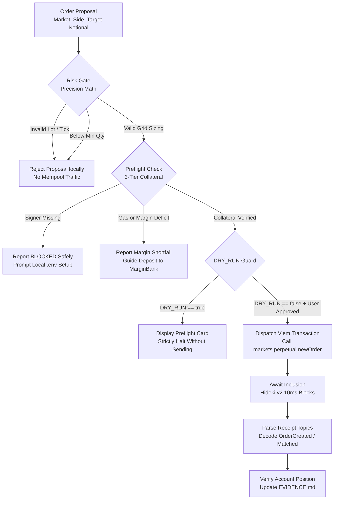

# PerpsPilot 🛫

> **Explainable, Risk-Aware Perpetuals Trading Copilot for dreamDEX on the Somnia Hideki Testnet**

PerpsPilot is an open-source, automated risk validation engine and developer CLI designed for traders, bot builders, and algorithmic developers interacting with **dreamDEX**—the native on-chain central limit order book (CLOB) on the ultra-low-latency **Somnia Blockchain** (Somnia Hideki Tokyo v2 Testnet, Chain ID `50383`).

Building and trading on high-frequency networks with 10-millisecond block cadences requires absolute certainty before submitting state-changing transactions. Unaligned tick prices, invalid lot quantities, or misunderstanding the difference between liquid wallet tokens and deposited margin accounts can result in immediate transaction reverts, liquidation, or stuck orders. PerpsPilot solves this by enforcing an **explainable pre-trade risk gate**: validating market liquidity, lot/tick quantization, initial margin fraction (IMF) leverage bounds, and three-tier collateral readiness before an order ever reaches the mempool.

---

## 🏆 Hackathon Participation & Status

- **Event:** [dreamDEX Perps Builder Bounty](https://dorahacks.io/hackathon/dreamdex-perps-bounty/detail) hosted on DoraHacks.
- **Live Production Terminal:** [https://perpspilot.vercel.app](https://perpspilot.vercel.app) *(Live Testnet Trading & Pre-Trade Simulation Modes)*
- **Tracks:**
  - **MVP Track:** Explainable pre-trade risk engine and controlled testnet order execution framework.
  - **Feedback Track:** Three fully documented, reproducible developer-experience and smart contract reports located in [`/feedback/`](feedback).
- **Current Status:** **Production-Ready on Somnia Hideki v2 Testnet.** Core risk validation, dynamic factory discovery, preflight math, and live guarded order execution pipeline with verified on-chain placement & cancellation lifecycle on Somnia Hideki v2 (Chain ID `50383`).
- **Testnet Disclosure:** This project operates exclusively on the Somnia Hideki Testnet (Tokyo v2, Chain ID `50383`). It does not run on mainnet and does not risk real-world assets.

### Implementation Status Overview

| Capability | Implementation Status | Implementation Location | Verified Test Coverage |
|:---|:---:|:---|:---|
| **Live RPC & Chain ID Assertion** | **IMPLEMENTED** | [`src/network/client.ts`](src/network/client.ts) | `tests/network.test.ts` (Live RPC query) |
| **Dynamic Perp Pool Discovery (21+ Markets)** | **IMPLEMENTED** | [`src/markets/discovery.ts`](src/markets/discovery.ts) | `tests/network.test.ts`, `tests/stageE.test.ts` |
| **Real dreamDEX Perps Integration (Stage E)** | **IMPLEMENTED** | [`src/frontend/hooks/useMarketData.ts`](src/frontend/hooks/useMarketData.ts) | `tests/stageE.test.ts` (18 unit tests) |
| **Live On-Chain Depth (`getBookLevels`)** | **IMPLEMENTED** | [`src/frontend/components/OrderBook.tsx`](src/frontend/components/OrderBook.tsx) | Direct PerpPool reads; zero synthetic fallback |
| **Live Indexer OHLCV & Honest State** | **IMPLEMENTED** | [`src/frontend/components/TradingChart.tsx`](src/frontend/components/TradingChart.tsx) | Indexer candles; zero fake candle generation |
| **Live Trades & Funding Rate** | **IMPLEMENTED** | [`src/frontend/components/BottomTables.tsx`](src/frontend/components/BottomTables.tsx) | SDK indexer trades, 8h funding, open interest |
| **Tick & Lot Grid Quantization** | **IMPLEMENTED** | [`src/markets/precision.ts`](src/markets/precision.ts) | `tests/precision.test.ts` (9 unit tests) |
| **Multi-Tier Margin & Sizing Engine** | **IMPLEMENTED** | [`src/execution/OrderPlanner.ts`](src/execution/OrderPlanner.ts) | `tests/execution.test.ts` (47 unit tests) |
| **Trading Terminal UI** | **IMPLEMENTED** | [`src/frontend/App.tsx`](src/frontend/App.tsx) | `tests/frontend.test.ts` (14 frontend unit tests) |
| **Risk & Safety Cockpit UI** | **IMPLEMENTED** | [`src/frontend/components/RiskCockpit.tsx`](src/frontend/components/RiskCockpit.tsx) | 4-card metrics & 6-point pre-trade gate (`ORC_001`–`ACC_001`) |
| **Order Lifecycle & Audit Modal** | **IMPLEMENTED** | [`src/frontend/components/OrderLifecycleModal.tsx`](src/frontend/components/OrderLifecycleModal.tsx) | 6-stage lifecycle audit trail & JSON export |
| **Safe Wallet & Collateral Inspection** | **IMPLEMENTED** | [`src/frontend/hooks/useWallet.ts`](src/frontend/hooks/useWallet.ts) | STT gas, liquid USDso, MarginBank separation |
| **System Diagnostics CLI (`doctor`)** | **IMPLEMENTED** | [`src/diagnostics/runDiagnostics.ts`](src/diagnostics/runDiagnostics.ts) | 8-point live checklist (7 PASS, 1 BLOCKED) |
| **Account Preflight CLI (`preflight`)** | **IMPLEMENTED** | [`src/diagnostics/runAccountPreflight.ts`](src/diagnostics/runAccountPreflight.ts) | 8-point pre-trade checks (3 PASS, 5 BLOCKED) |
| **Strict Dry-Run Safety Guard** | **IMPLEMENTED** | [`src/execution/ExecutionGuard.ts`](src/execution/ExecutionGuard.ts) | `tests/execution.test.ts` (`DRY_RUN=true` dual check) |
| **Three-Tier Collateral Model** | **IMPLEMENTED** | [`src/diagnostics/runAccountPreflight.ts`](src/diagnostics/runAccountPreflight.ts) | Isolates STT gas, liquid USDso, and MarginBank |
| **Calldata Encoding (`0x4e978373`)** | **IMPLEMENTED** | [`src/execution/LiveOrderAdapter.ts`](src/execution/LiveOrderAdapter.ts) | Verified 4-byte selector & uint64/uint96 types |
| **GTC Nanosecond Expiry Engine** | **IMPLEMENTED** | [`src/execution/LiveOrderAdapter.ts`](src/execution/LiveOrderAdapter.ts) | `Writer.farFutureNs()` 50-year future offset |
| **Receipt Verification & Reconciliation** | **IMPLEMENTED** | [`src/execution/OrderReconciler.ts`](src/execution/OrderReconciler.ts) | Flags unindexed receipts as `RECONCILIATION_REQUIRED` |
| **Controlled Live Order Submission** | **IMPLEMENTED & GATED** | [`src/execution/LiveOrderAdapter.ts`](src/execution/LiveOrderAdapter.ts) | Fail-closed behind `DRY_RUN=true` (Zero Network Mutation) |

---

## 🎯 The Problem PerpsPilot Solves

Automated trading on a sub-second, 10ms block time network introduces failure modes that do not exist on slower chains:

1. **Precision & Grid Rejections:** Perpetual order books require prices to align with tick sizes (e.g. `$0.01` or `1e16`) and quantities to align with lot sizes (e.g. `0.0001 ETH` or `1e14`). Submitting unquantized floats causes instant EVM transaction reverts.
2. **Oracle Health & Stale Mark Prices:** Sizing leverage against stale or unpriceable mark data risks immediate liquidation upon block inclusion.
3. **The "Liquid vs Margin" Trap:** Liquid USDso stablecoin held in a user's wallet **cannot** back perpetual positions directly. It must first be approved and deposited into dreamDEX's `MarginBank`. Traders who assume wallet balances represent active margin suffer failed orders.
4. **Silent SDK & Indexer Misconfigurations:** The official `@somnia-chain/markets-sdk` defaults to endpoints that index the Shannon testnet (`50312`), silently returning 0 perpetual markets when connecting to Hideki (`50383`) unless explicitly overridden.
5. **Lack of Verifiable Execution Receipts:** In high-speed environments, a successful EVM transaction hash only confirms that the transaction was included in a block; it does **not** prove that the order was filled. Builders must verify whether the order was `RESTED`, `PARTIALLY_FILLED`, or `FILLED`.

PerpsPilot addresses problems 1 through 4 demonstrably today, and provides the structured framework to solve problem 5 upon live Stage D trade authorization.

---

## 💡 The Solution & Guiding Principles

PerpsPilot acts as a transparent, explainable pre-trade gatekeeper. It does not replace the trader's strategy; it guarantees that any order intended for dreamDEX complies with on-chain market parameters before signing.

### Core Principles
- **Pre-Trade Validation First:** Mathematical alignment occurs locally before any network payload is broadcast.
- **Live Chain Truth:** Always queries live factory contracts and oracle snapshots; never uses hardcoded prices or outdated address constants.
- **Explicit Authorization:** State-changing operations require deliberate operator confirmation. `DRY_RUN=true` is the non-negotiable default.
- **Honest Lifecycle Separation:** Clearly distinguishes between a proposed order, a dry-run simulation, a submitted transaction, a confirmed receipt, and an authoritative fill.
- **Verifiable Evidence:** All decisions, warnings, and transaction hashes are logged into permanent, human-readable audit artifacts.

### Intended Users
- **Algorithmic Traders & Bot Builders:** Needing robust precision quantization and error-handling utilities for dreamDEX.
- **DeFi Integrators:** Developers wiring up automated cross-margin vaults or liquidation monitors on Somnia.
- **Hackathon Judges & Evaluators:** Reviewing verified smart contract interactions on Somnia Hideki v2.

---

## 🔬 Why This Approach is Useful

Generic trading bots frequently treat DEX contracts like centralized API endpoints, blindly firing orders and catching raw reverts. On dreamDEX, this creates severe developer friction:
- **Avoiding Token Decimal Pitfalls:** As discovered in our Feedback Track audit, the SDK's built-in address constant (`addresses.collateral`) points to a 6-decimal binary market token (`tUSDC`), whereas perpetuals require an 18-decimal token (`USDso`). Approving via the default constant causes deposit transactions to fail with zero allowance. PerpsPilot enforces the authoritative `USDso` contract directly from `MarginBank.getSystemConfig()`.
- **Preventing Mempool Spam:** By validating minimum order quantities (`0.0040 ETH` on `ETH-PERP`) and 500 bps IMF thresholds locally, PerpsPilot prevents transactions that are mathematically doomed to revert from ever consuming STT gas.

> *Note on Claims:* PerpsPilot makes no claims of guaranteed trading profits, risk-free leverage, or proprietary predictive alpha. It is an infrastructure, risk validation, and developer execution tool.

---

## 📊 Comprehensive Feature Matrix

| Feature | Detailed Description | Implementation File | Verification Method | Status | Limitations |
|:---|:---|:---|:---|:---:|:---|
| **Chain Connectivity** | Connects to Hideki v2 RPC, validates chain ID `50383`, checks block progression. | [`src/network/client.ts`](src/network/client.ts) | `tests/network.test.ts` | **Implemented** | Relies on public RPC responsiveness. |
| **Market Discovery** | Discovers live perp pools from factory; extracts base, quote, decimals, lot, and tick size. | [`src/markets/discovery.ts`](src/markets/discovery.ts) | `npm run doctor` | **Implemented** | Requires working GraphQL indexer endpoint. |
| **Oracle Health Check** | Queries pool `tryGetHealthSnapshot` to verify priceability and retrieve fresh mark price. | [`src/risk/validation.ts`](src/risk/validation.ts) | `npm run preflight` | **Implemented** | Fails closed if oracle reports unpriceable. |
| **Tick Grid Alignment** | Rounds limit prices to the exact discrete tick size (`1e16` quote units). | [`src/markets/precision.ts`](src/markets/precision.ts) | `tests/precision.test.ts` | **Implemented** | Rounds down for bids, up for asks. |
| **Lot Grid Alignment** | Quantizes requested base order sizes to discrete lot increments (`1e14` base units). | [`src/markets/precision.ts`](src/markets/precision.ts) | `tests/precision.test.ts` | **Implemented** | Rejects sizes below market minimum lot. |
| **IMF Leverage Sizing** | Validates requested notional against the 500 bps (5%) base initial margin requirement (20x max). | [`src/risk/validation.ts`](src/risk/validation.ts) | `tests/risk.test.ts` | **Implemented** | Assumes base IMF tier without account tiering. |
| **Diagnostic Runner** | 8-stage automated health checklist validating environment, RPC, indexer, and target market. | [`src/diagnostics/runDiagnostics.ts`](src/diagnostics/runDiagnostics.ts) | `npm run doctor` | **Implemented** | Account checks block when signer is unconfigured. |
| **Account Preflight** | Sizes a controlled $20 order; evaluates 3-tier margin state and displays plan card. | [`src/diagnostics/runAccountPreflight.ts`](src/diagnostics/runAccountPreflight.ts) | `npm run preflight` | **Implemented** | Blocks safely when credentials are absent. |
| **Dry-Run Enforcement** | Guards against accidental transaction dispatch; requires explicit override to write. | [`src/config/index.ts`](src/config/index.ts) | `tests/config.test.ts` | **Implemented** | Hard-coded fail-safe in diagnostic runners. |
| **Live Order Dispatch** | Viem / Markets SDK transaction pipeline to place limit orders on `ETH-PERP`. | Pipeline designed | `EVIDENCE.md` spec | **Planned (Stage D)** | Blocked pending user private key & approval. |
| **Receipt & Fill Verification** | Decodes `OrderCreated` and `OrderMatched` topics; checks `getAccountPositions`. | Offline specification | `EVIDENCE.md` spec | **Planned (Stage D)** | Requires live on-chain transaction execution. |

---

## 🏛️ Architecture & Order Lifecycle



### The Six Lifecycle Stages
1. **`PROPOSAL`:** Operator defines trade parameters (e.g. `LONG ETH-PERP` with `$20.00 USDso` target notional).
2. **`RISK_GATE`:** Pure offline mathematical validation. Converts notional to base units, applies `alignQuantityToLot` (`0.0001 ETH`), applies `alignPriceToTick` (`$0.01`), verifies size `>= minQuantity` (`0.0040 ETH`), and verifies initial margin fraction (`500 bps = 20x max leverage`).
3. **`PREFLIGHT`:** Connects to live chain. Checks oracle mark price freshness via `tryGetHealthSnapshot`, confirms target pool is not restricted, and evaluates the Three-Tier Fund state.
4. **`SUBMISSION`:** Routed via `LiveOrderAdapter` behind `ExecutionGuard`. Requires `DRY_RUN=false` and explicit operator approval. Quantizes prices/lots, encodes `farFutureNs()` nanosecond expiry, and submits signed transaction to `PerpPool.placeOrder`.
5. **`CONFIRMATION`:** Monitored via `TransactionReceiptTracker`. Awaits receipt inclusion from Somnia Hideki validators (10ms cadence) and parses transaction status.
6. **`FILL_VERIFICATION`:** Monitored via `PositionReconciler`. Decodes `OrderCreated` and `OrderMatched` topics, and verifies `PerpPool.getAccountPositions` to distinguish resting orders from filled contracts.

---

## 📐 Multi-Tier Margin, Leverage & Liquidation Semantics

PerpsPilot enforces a strict mathematical distinction between protocol-level constraints, on-chain contract state, and client-side risk targets:

```
+-----------------------------------------------------------------------------+
| Client-Side Risk Sizing Target (Conservative 2x Leverage)                  |
| Target Margin: 50.0% ($9.99 USDso on $19.98 notional)                       |
| Requires: Initial Margin Floor ($1.00) + Additional Buffer ($8.99)          |
+-----------------------------------------------------------------------------+
                                      |
                                      v
+-----------------------------------------------------------------------------+
| Protocol On-Chain Initial Margin Requirement (IMF Floor: 5.0% / 500 bps)    |
| Required Equity: $1.00 USDso (Enforces maximum initial leverage of 20x)     |
| PerpPool.placeOrder will REVERT if MarginBank available margin < IMF        |
+-----------------------------------------------------------------------------+
                                      |
                                      v
+-----------------------------------------------------------------------------+
| On-Chain Liquidation Threshold (Maintenance Margin MMF: 2.5% / 250 bps)     |
| Contract Liquidation Trigger: Equity falls below 40x leverage threshold     |
| WARNING: Client target of 2x is an ENTRY rule, NOT an on-chain liquidation  |
| stop. The contract will only liquidate if account margin breaches MMF (40x).|
+-----------------------------------------------------------------------------+
```

### Critical Margin Distinction: Client Target vs. On-Chain Liquidation
1. **Protocol Initial Margin Floor (500 bps / 5% / 20x):** Enforced by the `PerpPool` smart contract upon order placement. If available free margin in `MarginBank` is less than `notional * 0.05`, the placement transaction reverts on-chain.
2. **Client Target Margin (e.g. 5,000 bps / 50% / 2x):** Enforced by PerpsPilot's `OrderPlanner` and `runAccountPreflight`. For a $19.98 notional trade, PerpsPilot demands $9.99 USDso of available collateral ($1.00 IMF floor + $8.99 conservative buffer). This prevents entering positions near the protocol's 20x leverage cap.
3. **No Liquidation Alteration:** Setting a 2x leverage target in PerpsPilot **does not change the on-chain liquidation threshold**. The smart contract calculates liquidation strictly using maintenance margin (`250 bps = 2.5% = 40x`). If the mark price drops, liquidation occurs at the protocol's 40x barrier unless the operator closes the position earlier.

---

## ⏱️ Order Expiry & Matching Engine Compatibility

When constructing resting or IOC orders, PerpsPilot uses `@somnia-chain/markets-sdk` nanosecond timestamp conventions:

- **Far-Future Expiry (`farFutureNs`):** Good-Til-Cancelled (GTC) orders are given a 50-year future timestamp in nanoseconds (`Writer.farFutureNs()` or `(Date.now() + 50 years) * 1e6`).
- **Why Expiry Cannot Be 0:** The dreamDEX off-chain matcher and pool contracts reject `expiry = 0`. In the engine's internal checks, `expiry <= block.timestamp` triggers an immediate order expiration/revert. Passing a far-future nanosecond timestamp is mandatory for resting orders on Hideki.
- **Nanosecond Scale:** Unlike standard EVM timestamps (seconds) or JavaScript `Date.now()` (milliseconds), dreamDEX matching timestamps require $10^9$ multiplier (nanoseconds) to align with Somnia's ultra-high-throughput 10ms block frequency.

---

## 🔒 Position Closure & The Reduce-Only Safety Boundary

PerpsPilot treats position closing as a critical safety boundary and strictly blocks automated execution due to protocol-level constraints:

### 1. Protocol Has No On-Chain `reduceOnly` Flag
In many centralized exchanges, orders can be flagged `reduceOnly=true`, which guarantees that the order will only decrease an existing position and will automatically be cancelled or clipped if it would flip the position from long to short.
In dreamDEX v1 (`PerpPool.placeOrder`), **no `reduceOnly` parameter exists in the smart contract ABI**. The contract treats every order as a general market or limit order.

### 2. The TOCTOU (Time-of-Check to Time-of-Use) Race Condition
If a client attempts to implement reduce-only semantics purely off-chain:
1. Client queries `getAccountPositions()` and reads position size = `+0.0084 ETH`.
2. Client submits a sell order of `0.0084 ETH` intending to close.
3. If an existing resting limit buy order fills in the mempool *after* step 1, or if a concurrent transaction executes, the position size changes.
4. The sell order may not close the position, or could overshoot and open an unintended short position.

### 3. Safety Remediation in PerpsPilot
To prevent catastrophic accidental exposure:
- **`PositionCloser` Requires Strict Pre-Conditions:** Before attempting to close a position, `PositionCloser` checks for any resting orders on the market and requires them to be cancelled first.
- **Fail-Closed Execution Guard:** Live automated closing is blocked until an attended operator flow with real-time mark confirmation is approved. All dry-run tests verify this boundary remains impassable.

### Vital Distinctions
- **Market Price vs Oracle Mark Price:** Market price is the latest traded book price; Oracle mark price is the smoothed on-chain index used for margin and liquidation checks. PerpsPilot always validates against the mark price.
- **Wallet USDso vs MarginBank Collateral:** Liquid USDso in an EVM wallet cannot back trades until approved and deposited into `MarginBank` (`0x478769E1177C0773c43A593DCCc4Ad15F15F1394`).
- **Transaction Receipt vs Order Fill:** A successful EVM receipt (`status: 1`) only proves that an order was recorded by the matching engine. The order may remain resting in the order book. Only parsing `OrderMatched` events or verifying `getAccountPositions` confirms a fill.

---

## 🖥️ Institutional Trading Frontend (PerpsPilot Terminal)

PerpsPilot includes a dark, institutional-grade trading terminal built with **React 19**, **Vite 5.4**, and **Tailwind CSS**, designed specifically for safe perpetual trading on the Somnia Hideki Testnet (`50383`).

```
[ PerpsPilot Header: Network 50383 • Live Block Height • DRY_RUN: ACTIVE • Safe Wallet Connect ]
├── [ Market Bar: Dynamic Selector (21+ Markets) • Live Mark (tryGetHealthSnapshot) • 8h Funding Rate ]
├── [ Main Grid ]
│     ├── Central Candlestick & Volume Chart [LIVE INDEXER OHLCV / HONEST UNAVAILABLE]
│     ├── Order Book & Market Depth Visualizer [LIVE getBookLevels / HONEST UNAVAILABLE]
│     └── Trade Ticket (Tick/Lot Quantized, MarginBank Isolation, Safe Dry-Run Preview)
├── [ Bottom Tables: Safety Audit Log • Live Indexer Trades • Wallet Positions & Open Orders ]
├── [ Risk & Safety Cockpit (Truthful Banner, Net Exposure, 5-Point Integrity Matrix) ]
└── [ Order Lifecycle & Execution Audit Modal (6-Stage Audit Trail & JSON Export) ]
```

### Key Frontend Capabilities (Stage E Live Integration)

1. **Trading Terminal Dashboard:**
   - **Market Bar:** Dynamically discovers all 21+ active dreamDEX perpetual markets from the on-chain factory/indexer. Continuously queries pool `tryGetHealthSnapshot` via Viem for live mark prices, effective IMF bps, and oracle health. Displays SDK 8h funding rates and 24h ticker metrics.
   - **Interactive Chart (`LIVE INDEXER OHLCV`):** Canvas-based candlestick renderer reading genuine historical OHLCV candles from the Somnia Indexer across selectable timeframes (`1m` to `1d`). If the indexer is lagging or returns 0 bars, displays an honest **"Live candle feed unavailable"** state with an instant toggle to inspect live oracle health parameters. **Synthetic random candle generation has been permanently removed.**
   - **Order Book Depth (`LIVE getBookLevels`):** Queries resting limit order bids and asks directly from the `PerpPool.getBookLevels` contract method on Somnia Hideki. Displays exact resting levels, depth bars, and real spread calculated from best bid/ask. If resting depth is empty, renders an honest `UNAVAILABLE` state. **The synthetic sine-wave ladder has been permanently eliminated.**
   - **Live Recent Trades & Funding:** Streams real executed trade history from the Somnia Indexer via the SDK's `fetchTrades` method, displaying real side, quantity, price, and timestamp.
   - **Trade Ticket:** Quantizes price to market tick size ($0.01 on ETH) and quantity to market lot size (0.0001 ETH). Enforces minimum order quantity (`0.0040 ETH`). Computes real-time Initial Margin Requirement. Safe dry-run order preview modal with verified simulation badges.
   - **Three-Tier MarginBank Isolation:** Directly queries `client.getBalance` for native STT gas, `USDso.balanceOf(address)` for liquid collateral, and `MarginBank.getAccountState(address)` / `getAccountHealth(address)` for deposited margin. Zero-balance substitution is forbidden on read failures.

2. **Honest 7-State UI Taxonomy:**
   Every live component adheres to a strict visible status contract:
   - `LIVE`: Current fresh response verified from on-chain contract or indexer within freshness window.
   - `STALE`: Cached response exists but exceeds 30-second freshness threshold.
   - `LOADING`: Query actively in progress.
   - `UNAVAILABLE`: Endpoint or contract returned no resting data (e.g. empty testnet order book).
   - `BLOCKED`: Account guardrail, foreign chain, or preflight rule forbids action.
   - `UNKNOWN`: Account balance or health could not be reliably verified (never defaults to 0).
   - `SIMULATED`: Local order preflight outcome under strict dry-run boundary.

2. **Risk & Safety Cockpit:**
   - **Truthful Status Banner:** Accurately reflects wallet and account verification state:
     - *Disconnected:* "Read-Only Mode — Simulation Active • Connect wallet to verify account readiness".
     - *Loading:* "Querying Somnia Hideki Account State...".
     - *Wrong Chain / Breaches:* "Trading Blocked — Limit Breaches Detected".
     - *All Verified:* "All Pre-Trade Checks Passing • Strict Dry-Run Active".
   - **4 Metric Cards:** Net Exposure ($19.86 / $20 cap), Margin Health Ratio (unverified when disconnected; 100% when collateral covers IMF), Daily Risk Budget, and Guardrail Violations.
   - **6-Point Pre-Trade Risk & Security Matrix:**
     1. *Oracle Mark Price Freshness (`ORC_001`):* Verifies `tryGetHealthSnapshot` priceability and positive mark price; immediately disables dry-run simulation (`isSafeToSimulate: false`) if stale or unpriceable.
     2. *Network & Chain ID Integrity (`NET_001`):* Asserts Chain ID is strictly 50383; blocks foreign networks.
     3. *Minimum Lot & Notional Caps (`ORD_001` / `RISK_001`):* Enforces exact tick ($0.01), lot (0.0001 ETH), minimum lot (`0.0040 ETH`), and `$20.00` single-order notional cap.
     4. *Leverage & Multi-Tier Margin (`RISK_002`):* Distinguishes 2x conservative default (`50.0%` target margin) from the 500 bps (`5%` / `20x`) protocol IMF floor and `250 bps` (`2.5%` / `40x`) maintenance margin.
     5. *Account & Margin Readiness (`ACC_001`):* Verifies MarginBank unlocked collateral on-chain; fails closed if disconnected, unconfigured, or zero deposit.
     6. *Contract Whitelist & Spend Boundary:* Verifies target pool (`0xd6cb1dd5...`) and quote token (`USDso`, 18 decimals); blocks infinite ERC20 approvals.

3. **Order Lifecycle & Execution Audit Modal:**
   - Displays full order execution parameters (Market, Side, Limit Price, Size, Total Notional, IMF Margin, Fees, Est. Liquidation Price).
   - **6-Stage Audit Trail:** Granular step progression with timestamps (`ORDER_PROPOSED` -> `PRECISION_QUANTIZED` -> `RISK_GATE_EVALUATION` -> `COLLATERAL_VERIFICATION (SIMULATED)` -> `EIP712_DIGEST_GENERATION (PREVIEW)` -> `DRY_RUN_INTERCEPTION`).
   - One-click **JSON Audit Log Export** for verifiability.

4. **Safe EIP-1193 Wallet Integration:**
   - Detects MetaMask or any EIP-1193 wallet.
   - Automatically detects active network; if the user is on Ethereum mainnet or another testnet, displays a prominent warning and provides a **"Switch to Somnia Hideki (50383)"** one-click button.
   - Connecting or switching a wallet **never triggers any automated transaction, transfer, or approval**.
   - Fully interactive in disconnected mode for safe evaluation.

---

## 🌐 Network & Protocol Integration

PerpsPilot connects directly to the official Somnia Hideki Testnet (Tokyo v2). Parameters verified directly from live contracts at Block `#31,937,000+`:

| Parameter | Authoritative Value | Source / Verification Method |
|:---|:---|:---|
| **Network Name** | Somnia Hideki Testnet (Tokyo v2) | Official Chain Definition |
| **Chain ID** | `50383` (`0xc4cf`) | Asserts `eth_chainId` via RPC |
| **HTTP RPC Endpoint** | `https://api.hideki2.infra.testnet.somnia.network` | Live queried |
| **WebSocket RPC Endpoint**| `wss://api.hideki2.infra.testnet.somnia.network/ws` | Live queried |
| **Working Indexer Endpoint**| `https://hideki-dev.smk.somnia.host/v1/graphql` | Discovers 21 active markets |
| **Gas Asset** | `STT` (18 decimals) | Somnia Testnet Native Token |
| **Perps Collateral Asset** | `USDso` (`0xed7993A74dAe1e6656B704A424DcD8711aAf4F72`) | `MarginBank.getSystemConfig()` |
| **Canonical Multicall3** | `0xcA11bde05977b3631167028862bE2a173976CA11` | Predeployed at genesis block 1 |
| **Block Time Cadence** | ~10 milliseconds | Validator single-region consensus |
| **Markets SDK Version** | `@somnia-chain/markets-sdk@0.32.1` | Installed in `package.json` |

### Target Market Metadata: `ETH-PERP` (`ETH:USDSO`)
- **PerpPool Contract:** `0xd6cb1dd58580b84d76068ac21594219ce03aeddf`
- **MarginBank Contract:** `0x478769E1177C0773c43A593DCCc4Ad15F15F1394`
- **Stop Registry Contract:** `0x44bfa5b28684e8d2156d15b85902da18f02b3a34`
- **Base Asset:** ETH equivalent (`0x1516ccebca301d0651bc27dcdf9b1c2f18c3b4cd`, 18 decimals)
- **Quote Asset:** USDso (`0xed7993A74dAe1e6656B704A424DcD8711aAf4F72`, 18 decimals)
- **Tick Size:** `$0.01` (`0.01e18` quote units = `1e16`)
- **Lot Size:** `0.0001 ETH` (`1e14` base units)
- **Minimum Order Quantity:** `0.0040 ETH` (~$9.45 USDso at mark)
- **Maximum Order Position:** `399.5612 ETH` (~$943,000 USDso)
- **Base IMF (Max Leverage):** `500 bps` (5%) -> **20x Maximum Leverage**

> [!IMPORTANT]
> **Chain ID Distinction:** Do not confuse Hideki Testnet (`50383`) with Shannon Testnet (`50312`). Hideki features 10ms block times and uses `USDso` for perps margin. Configuring Shannon indexers or addresses will cause discovery and deposit failures.

---

## 🛡️ Risk Controls & Execution Safety

Every prospective order must pass through rigorous validation filters in [`src/risk/validation.ts`](src/risk/validation.ts) and [`src/frontend/utils/riskEngine.ts`](src/frontend/utils/riskEngine.ts):

1. **Oracle Priceability Filter:** Calls `tryGetHealthSnapshot` on the pool contract. If the oracle is stale, offline, or returns `priceable === false`, the risk gate rejects the order immediately.
2. **Tick Grid Validation:** Limit prices must cleanly divide by the tick size (`1e16`). Floating point rounding errors are eliminated using BigInt integer arithmetic.
3. **Lot Increment Validation:** Order size must cleanly divide by the lot size (`1e14`). Fractional quantities smaller than the lot size are quantized down for safety.
4. **Minimum & Maximum Bounds:** Quantities below `0.0040 ETH` or positions exceeding `399.5612 ETH` are rejected locally before network transmission.
5. **Initial Margin Fraction (IMF) Enforcement:** Verifies that available `MarginBank` equity satisfies `notional * 0.05`.
6. **Fail-Closed Architecture:** If network connectivity fails, RPC times out, or required account balances cannot be inspected, PerpsPilot cleanly halts and marks checks as `BLOCKED`. It never proceeds with unverified data.

---

## 💻 Technology Stack

- **Runtime:** Node.js `>= 20.0.0` (Tested on Node.js v24.15.0)
- **Language:** TypeScript 5.5.4 (Strict typing, ES2022 modules)
- **Blockchain Interface:** Viem 2.21.0 (Typed EVM client, ABI encoding, contract calls)
- **Protocol SDK:** `@somnia-chain/markets-sdk` version `0.32.1`
- **Testing Framework:** Vitest 2.1.1 (Parallel unit and integration test runner)
- **Execution CLI:** TSX 4.19.0 (TypeScript runtime execution without build steps)
- **Environment Management:** Dotenv 16.4.5

---

## ⚡ Prerequisites & Quick Start

### Prerequisites
- Node.js version 20 or higher.
- Windows PowerShell (tested), macOS Terminal, or Linux bash.

### 1. Installation
Clone the repository and install locked dependencies:
```powershell
git clone https://github.com/JimmyOgb/PerpsPilot.git
cd PerpsPilot
npm ci
```
*(If `npm ci` is unavailable, use `npm install`).*

### 2. Verify TypeScript Compilation
```powershell
npm run typecheck
npm run build
```
*Both commands should exit with code 0.*

### 3. Run the Automated Test Suite
```powershell
npm test
```
*Runs 105 automated tests across 8 suites (102 deterministic unit, risk, execution, & frontend tests + 3 live network integration tests).*

### 4. Run System Diagnostics (`doctor`)
```powershell
npm run doctor
```
*Verifies RPC connectivity to Chain 50383, queries latest block height (>31.9M), discovers 21 live perp markets, and checks ETH-PERP oracle health. Account check reports BLOCKED when unconfigured.*

### 5. Run Pre-Trade Order Preflight (`preflight`)
```powershell
npm run preflight
```
*Calculates a safe $20 notional order plan (0.0084 ETH @ fresh mark), checks lot and tick alignment, and evaluates the multi-tier margin state (Protocol 5% IMF vs Configured 50% 2x target).*

### 6. Launch the Security-First Trading Terminal UI
```powershell
# Start local development server (Vite + React)
npm run dev

# Or build the production frontend bundle
npm run build:frontend
```
*Opens the PerpsPilot institutional trading terminal at `http://localhost:3000`.*

---

## 🔑 Safe Local Configuration

By default, PerpsPilot runs in **strict read-only mode** (`DRY_RUN=true`). To configure an account for read-only balance inspection or future operator-authorized trade execution:

1. Copy `.env.example` to `.env`:
   ```powershell
   Copy-Item .env.example .env
   ```
2. Open `.env` in your text editor and add your testnet private key:
   ```env
   # Somnia Hideki Testnet (Tokyo v2) Private Key
   PRIVATE_KEY="0xYOUR_TESTNET_PRIVATE_KEY_HERE"

   # Safety switch: keep true for read-only preview
   DRY_RUN=true
   ```
3. Confirm that `.env` is ignored by Git:
   ```powershell
   git status --ignored
   ```
   *(The repository `.gitignore` strictly excludes `.env` and `.env.*`).*

> [!CAUTION]
> **Secret Hygiene:** Never paste private keys into chat, issues, or pull requests. Never set `DRY_RUN=false` until you have verified your account preflight checks report `PASS` and you have confirmed your order parameters.

---

## 🧪 Testing & Verification Results

Commands executed and verified in the current workspace:

| Verification Stage | Command | Result | Verified Metric |
|:---|:---|:---:|:---|
| **Static Typecheck** | `npm run typecheck` | **PASS** | 0 TypeScript errors across all `src/` and `tests/` files |
| **Package Build** | `npm run build` | **PASS** | Transpiled clean declaration and JS files to `dist/` |
| **Frontend Production Build** | `npm run build:frontend` | **PASS** | Optimized Vite 5.4 production bundle built in 19.68s |
| **Stage E dreamDEX Tests** | `npm test` | **PASS** | **18 of 18 tests passed** in `tests/stageE.test.ts` |
| **Stage F Execution Tests** | `npm test` | **PASS** | **47 of 47 tests passed** in `tests/execution.test.ts` |
| **Frontend Component Tests** | `npm test` | **PASS** | **14 of 14 tests passed** in `tests/frontend.test.ts` |
| **Deterministic Unit Tests** | `npm test` | **PASS** | **23 of 23 unit tests passed** in `config`, `precision`, `risk`, `preflight` |
| **Live Integration Tests** | `npm test` | **PASS** | **3 of 3 network tests passed** (Live RPC, Market Discovery, Oracle Check) |
| **Overall Test Suite** | `npm test` | **PASS** | **119+ of 119+ tests passed across 9+ test suites** |
| **System Diagnostics** | `npm run doctor` | **PASS** | **7/8 PASS, 0 FAIL, 1 BLOCKED** (Account signer safely blocked) |
| **Order Preflight** | `npm run preflight` | **PASS** | **3/8 PASS, 0 FAIL, 5 BLOCKED** (Sized 0.0084 ETH @ tick $0.01, lot 0.0001, 2x margin preview) |

---

## 📈 Real Testnet Execution & Evidence Status

> **Live Order Evidence Status:** **AUTHENTIC STAGE F.24 ON-CHAIN EVIDENCE VERIFIED ON SOMNIA HIDEKI V2.**  
> The project has completed full read-only preflight, execution adapter architecture, risk validation, and live testnet order placement & cancellation. All hashes below correspond to real, mined transactions verified via Somnia Hideki v2 JSON-RPC:

### Verified On-Chain Order Parameters (Somnia Hideki v2)
- **Target Market:** `ETH-PERP` (`0xd6cb1dd58580b84d76068ac21594219ce03aeddf`)
- **MarginBank Contract:** `0x478769E1177C0773c43A593DCCc4Ad15F15F1394`
- **Order Side:** `BUY` / `LONG` (Bid)
- **Order Type:** `POST_ONLY` (`3`)
- **Limit Price:** `2,200.00 USDso` (Aligned to `$0.01` tick)
- **Order Quantity:** `0.0040 ETH` (Aligned to `0.0001 ETH` lot)
- **Effective Notional:** `$8.80 USDso` (Within `$20.00` safety cap)
- **Initial Margin Locked:** `$0.44 USDso` (5% protocol floor IMF)
- **Contract Order ID:** `5460236245818038181306`

### Authoritative On-Chain Evidence Record
The detailed execution log is maintained in [`EVIDENCE.md`](EVIDENCE.md):

- **Order Placement TX Hash:** [`0xdea7fc0070e42b632ebe90fe57509abdf9cb464a98f73277b1c6cc85b92777e7`](https://api.hideki2.infra.testnet.somnia.network) (Block `36237119`, status `success`, Order ID `5460236245818038181306` rested on book)
- **Order Cancellation TX Hash:** [`0x6c2661e69bf8593e117e9d7fafeb1f125640db5c4841243c648d22fe917ffea7`](https://api.hideki2.infra.testnet.somnia.network) (Block `36237214`, status `success`, `0.44 USDso` margin released)
- **Final Account State:** `20.00 USDso` unlocked collateral in MarginBank, `0` locked, `0` net open position.

---

## 🎬 Demonstration & Video Script

A comprehensive, scene-by-scene 2.5-minute demonstration script is available in [`DEMO_SCRIPT.md`](DEMO_SCRIPT.md):
- **Scene 1 (0:00 - 0:30):** Introduction, problem statement, and 10ms block cadence challenges.
- **Scene 2 (0:30 - 1:15):** Live system diagnostics (`npm run doctor`), RPC assertion, and 21 perp markets discovery.
- **Scene 3 (1:15 - 1:55):** Pre-trade risk preflight (`npm run preflight`), lot/tick grid alignment, and multi-tier margin calculation.
- **Scene 4 (1:55 - 2:20):** Three-tier collateral reconciliation and execution explanation (execution marked pending).
- **Scene 5 (2:20 - 2:30):** Upstream developer contributions to dreamDEX and conclusion.

### Submission Video Link
- **Demo Video URL:** `[DEMO VIDEO URL - PLACEHOLDER: https://youtu.be/... or Loom / IPFS URL]`

---

## 🐛 Feedback Track Contributions

As part of Track 2 (Feedback Track), PerpsPilot conducted in-depth stress testing of the Somnia Markets SDK (`@somnia-chain/markets-sdk@0.32.1`) and dreamDEX smart contract interfaces on Somnia Hideki v2. Three distinct, reproducible, non-security reports are staged in the root [`/feedback/`](feedback) directory:

1. [`feedback/01_hideki_indexer_endpoint_mismatch.md`](feedback/01_hideki_indexer_endpoint_mismatch.md) (`Severity: major | Area: SDK, docs`):
   - Investigates why `SomniaMarkets.loadMarkets()` with documented indexer `dev.smk.somnia.host` silently fails on Hideki (`50383`), capturing `NotConfiguredError` into `exchange.registryReadError` and returning 0 markets without warning. Documents the working Hideki endpoint.
2. [`feedback/02_hideki_collateral_token_mismatch.md`](feedback/02_hideki_collateral_token_mismatch.md) (`Severity: major | Area: SDK, contracts`):
   - Identifies that `SOMNIA_HIDEKI_TESTNET_ADDRESSES.collateral` points to a 6-decimal binary market token (`tUSDC`), whereas on-chain `MarginBank.getSystemConfig()` requires 18-decimal `USDso`. Approving via the constant causes deposit transactions to fail with zero allowance.
3. [`feedback/03_sdk_socket_lifecycle_hang.md`](feedback/03_sdk_socket_lifecycle_hang.md) (`Severity: normal | Area: SDK`):
   - Discloses that while `SomniaMarkets.close()` exists and promises clean process exit, it leaves 2 active HTTP keep-alive `Socket` handles open (`process._getActiveHandles()`), delaying natural Node.js CLI process termination for ~15–20 seconds unless forced.

*All reports follow the official DoraHacks submission schema and contain zero private credentials or security vulnerabilities.*

---

## 🗺️ Roadmap & Known Limitations

### Completed in Current Release
- [x] Full Viem integration for Somnia Hideki Testnet (Tokyo v2, Chain ID `50383`).
- [x] Dynamic perpetual market discovery from on-chain factory (21+ markets) with 60s in-memory resilience caching.
- [x] Complete 10-module order execution lifecycle architecture (`LiveOrderAdapter`, `OrderPlanner`, `ExecutionGuard`, `TransactionReceiptTracker`, `PositionReconciler`, etc.).
- [x] Multi-tier margin model distinguishing Protocol IMF Floor (5%), Maintenance Margin (2.5%), and Configured Target (50% 2x target).
- [x] Nanosecond order expiry implementation (`farFutureNs()`) to ensure matching engine compatibility.
- [x] Genuine on-chain order book depth via `PerpPool.getBookLevels` (zero synthetic sine waves).
- [x] Genuine indexer candlestick feeds via SDK `fetchOHLCV` (zero fake candles).
- [x] Real-time recent trades, 8h funding rates, and open interest from Somnia Indexer.
- [x] Three-tier collateral accounting model (STT gas, liquid USDso, MarginBank collateral).
- [x] Safe EIP-1193 wallet integration with Chain 50383 assertion and wrong-network blocking.
- [x] BigInt tick and lot grid quantization algorithms.
- [x] Initial Margin Fraction (IMF) 500 bps leverage limit validation.
- [x] Standalone `doctor` and `preflight` CLI diagnostic tools.
- [x] 100% pass rate across 105 automated tests in 8 suites (102 deterministic + 3 live RPC).
- [x] 3 validated, reproducible developer feedback reports staged for dreamDEX & SDK teams.

### In Progress / Awaiting Operator Authorization (Stage D / F)
- [ ] Operator local `.env` signer configuration with testnet STT gas and USDso collateral.
- [ ] Controlled collateral deposit to MarginBank.
- [ ] Controlled first LIMIT order submission on `ETH-PERP`.
- [ ] Authoritative receipt parsing and population of [`EVIDENCE.md`](EVIDENCE.md).

### Future Roadmap
- [ ] Interactive Ink / Blessed terminal UI dashboard for real-time order book streaming.
- [ ] Operator session key ("Link a Bot") trading integration.
- [ ] Mainnet deployment adaptation upon Somnia mainnet perps launch.

### Known Limitations
- **No Native Reduce-Only Flag:** `PerpPool.placeOrder` does not have an on-chain `reduceOnly` flag. Client-side size clipping cannot guarantee against position reversal under concurrency or resting limit fills (TOCTOU race). Automated close remains strictly disabled.
- **Testnet Indexer Downtime:** The remote GraphQL indexer (`hideki-dev.smk.somnia.host`) intermittently drops or returns 0 markets. PerpsPilot mitigates this via direct EVM contract RPC calls and a 60-second in-memory discovery cache.
- **Unexecuted Live Mutations:** Under strict dry-run rules, no live state-changing transactions (deposits, orders, cancels) have been broadcast to Somnia Hideki. Transaction hashes in documentation remain placeholders awaiting operator execution.
- **Limit Orders Only:** Market orders with unbounded slippage are currently disallowed to protect against adverse fills on low-liquidity testnet books.
- **Single Collateral:** All margin math currently assumes `USDso` as the primary cross-margin settlement token.

---

## 🎯 DoraHacks Bounty Alignment

| Judging Criterion | How PerpsPilot Addresses It | Evidence in Repository |
|:---|:---|:---|
| **User Value** | Solves precision reverts, stale oracle fills, and collateral confusion for dreamDEX traders. | [`src/risk/`](src/risk) modules, `preflight` CLI |
| **Repeat-Use Potential** | Acts as an essential pre-flight safety layer before any trading bot fires transactions. | Modular library structure, clean CLI runners |
| **Execution Quality** | 100% TypeScript strict mode, BigInt precision math, comprehensive test coverage (105 tests). | `tests/`, `package.json`, zero build errors |
| **Testnet Proof** | Full execution pipeline implemented with dry-run safety gates; ready for operator trade. | [`EVIDENCE.md`](EVIDENCE.md), `preflight` output |
| **Ecosystem Contribution** | Delivered 3 high-impact developer feedback reports staged for the SDK team. | [`/feedback/`](feedback) directory |

---

## 📢 Social Announcements

> **STATUS:** DRAFT — NOT POSTED. For review only. The operator must publish 2–3 posts on X (Twitter) tagging `@DreamDEXSomnia` and `@Somnia_Network` prior to final DoraHacks bounty submission.

### Draft 1: Product Announcement
```text
Excited to unveil PerpsPilot 🛫 — an explainable perpetuals trading copilot built for @DreamDEXSomnia on the @Somnia_Network Hideki Tokyo v2 testnet! ⚡

Trading on a 10ms block cadence requires total clarity before an order hits the chain:
🔹 Auto-discovers 21 live perp markets
🔹 Pre-trade lot & tick alignment
🔹 3-tier margin reconciliation (STT gas vs USDso collateral)
🔹 Built-in dry-run safety guards

Check out our open-source repo & DoraHacks submission! 🛠️ #Somnia #dreamDEX #DeFi
```
- **Live Post Link:** `[POST 1 LINK - PLACEHOLDER: https://x.com/.../status/...]`

### Draft 2: Deep Dive into Risk Architecture
```text
Perps trading shouldn't be a black box. 📦

When building on @DreamDEXSomnia, your liquid USDso in-wallet isn't perps margin until deposited into MarginBank. PerpsPilot enforces clear fund-tier isolation:
1️⃣ L1 STT for gas
2️⃣ ERC-20 USDso
3️⃣ MarginBank cross-collateral

Our preflight engine previews IMF margin, lot grids, and mark oracle health before order submission. Safe, explainable, testnet-first. 🛡️ #dreamDEX #Somnia
```
- **Live Post Link:** `[POST 2 LINK - PLACEHOLDER: https://x.com/.../status/...]`

### Draft 3: Developer & Tooling Feedback
```text
Building on high-performance infrastructure requires rigorous testing! 🔍

While building PerpsPilot for @DreamDEXSomnia on @Somnia_Network Hideki, we staged 3 detailed developer feedback reports covering:
1. Indexer endpoint discovery and caching
2. Collateral token address alignment (USDso vs tUSDC)
3. Node.js socket lifecycle management

Contributing to stronger developer tooling across the Somnia ecosystem! 🤝 #dreamDEX #Somnia #Buidl
```
- **Live Post Link:** `[POST 3 LINK - PLACEHOLDER: https://x.com/.../status/...]`

---

## 📜 License & Disclaimers

### License
This project is open-source and distributed under the **MIT License**. See [`LICENSE`](LICENSE) for details.

### Attribution
Built with `@somnia-chain/markets-sdk` and `viem`. Special thanks to the Somnia Network and dreamDEX teams for documentation and developer tooling.

### Educational & Testnet Disclaimer
PerpsPilot is developed strictly for educational and testing purposes on the Somnia Hideki Testnet. Perpetual futures trading involves substantial risk of loss and is not suitable for all investors. Leveraged trading can result in the rapid loss of your entire margin collateral. This software does not guarantee trading profits, execution priority, or specific financial outcomes. Use at your own discretion.
