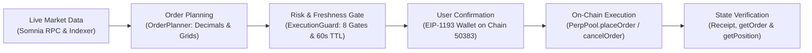

# PerpsPilot

**A risk-aware copilot for dreamDEX perpetuals on Somnia.**

Perpetual futures trading on a 10-millisecond block-time network requires clear visibility into market conditions, order behavior, collateral rules, and execution constraints before a transaction is signed. Unaligned tick prices, invalid lot quantities, stale oracle mark prices, or confusion between wallet token balances and deposited margin accounts can cause immediate transaction reverts or unintended exposure.

PerpsPilot is an open-source trading terminal, pre-trade validation engine, and CLI toolkit built for **dreamDEX** on the **Somnia Hideki Testnet (Tokyo v2, Chain ID `50383`)**. Rather than acting as an autonomous trading bot with unrestricted authority, PerpsPilot is designed around **risk-aware, user-confirmed execution**: it inspects live on-chain market parameters, enforces deterministic pre-trade and freshness safeguards, separates simulated previews from live transactions, and verifies post-submission order and position states directly against the chain.

---

## Quick Navigation for Judges

- **Live Application:** [https://perpspilot.vercel.app](https://perpspilot.vercel.app)
- **Source Code:** [https://github.com/JimmyOgb/PerpsPilot](https://github.com/JimmyOgb/PerpsPilot) (Verified release commit: [`aff7470`](https://github.com/JimmyOgb/PerpsPilot/commit/aff7470))
- **Demo Video (YouTube, 2m 54s, 1080p):** [https://youtu.be/fgC5cAnD7Ow?si=uszAcyz1tAp-sYTm](https://youtu.be/fgC5cAnD7Ow?si=uszAcyz1tAp-sYTm)
- **X / Public Build Updates:**
  1. [PerpsPilot — Demo Video & Verifiable Order Lifecycle Launch](https://x.com/JimmyOgb12/status/2116049016722960552)
  2. [PerpsPilot — Building the Risk-Aware Trading Cockpit & Traceable Market Integration](https://x.com/JimmyOgb12/status/2115411561497976873)
  3. [PerpsPilot — Shipping the Live PerpsPilot Trading Companion on Vercel](https://x.com/JimmyOgb12/status/2115537547887587665)
- **Technical Documentation & Evidence:**
  - [On-Chain Execution Evidence Dossier (`EVIDENCE.md`)](EVIDENCE.md)
  - [Demonstration Walkthrough Script (`DEMO_SCRIPT.md`)](DEMO_SCRIPT.md)
  - [Feedback Track Developer Reports (`feedback/`)](feedback)

---

## What PerpsPilot Does

PerpsPilot combines a React/TypeScript web terminal with modular TypeScript risk and execution libraries and CLI diagnostic runners. Every capability below is implemented in the repository and verified against live Somnia Hideki v2 contracts or deterministic unit tests:

| Capability | What Is Implemented | Data Source (Live Chain vs. Local) | Primary Implementation |
| :--- | :--- | :--- | :--- |
| **Dynamic Market Discovery** | Discovers 21 active perpetual pools from the Hideki v2 `PerpPoolFactory` and GraphQL indexer, with a 60s resilience cache and seeded fallback registry. | **Live On-Chain & Indexer** (`PerpPoolFactory`, GraphQL) | [`src/markets/discovery.ts`](src/markets/discovery.ts), [`src/frontend/hooks/useMarketData.ts`](src/frontend/hooks/useMarketData.ts) |
| **Live Oracle & Depth Reads** | Queries `PerpPool.tryGetHealthSnapshot` for mark price, priceability, and IMF bps; queries `PerpPool.getBookLevels` for resting bids/asks and Somnia Indexer for OHLCV candles and recent trades. | **Live On-Chain & Indexer** (Displays explicit `UNAVAILABLE` if book or feed is empty; no synthetic data) | [`src/frontend/components/OrderBook.tsx`](src/frontend/components/OrderBook.tsx), [`src/frontend/components/TradingChart.tsx`](src/frontend/components/TradingChart.tsx) |
| **Order Preparation & Preview** | Quantizes prices to market tick grids and quantities to lot grids, computes notional value, Initial Margin Requirement (IMF), estimated fees, and estimated liquidation price. | **Local BigInt & Decimal Math** seeded by live mark price and pool parameters | [`src/execution/OrderPlanner.ts`](src/execution/OrderPlanner.ts), [`src/frontend/components/TradeTicket.tsx`](src/frontend/components/TradeTicket.tsx) |
| **Pre-Trade Execution Guard** | Evaluates an 8-gate safety checklist covering chain ID (`50383`), oracle freshness, minimum lot size, `$20.00` single-order notional cap, margin sufficiency, and plan digest integrity. | **Local Deterministic Guard** over live network and wallet state | [`src/execution/ExecutionGuard.ts`](src/execution/ExecutionGuard.ts), [`src/frontend/utils/riskEngine.ts`](src/frontend/utils/riskEngine.ts) |
| **60-Second Proposal Freshness** | Preserves the original proposal timestamp and enforces a strict 60-second time-to-live (`maxPlanAgeMs: 60_000`). Expired proposals are blocked until refreshed. | **Local Timestamp & Guard Assertion** | [`src/frontend/components/OrderLifecycleModal.tsx`](src/frontend/components/OrderLifecycleModal.tsx), [`src/execution/ExecutionGuard.ts`](src/execution/ExecutionGuard.ts) |
| **Explicit Order-Type Handling** | Supports `POST_ONLY` (contract enum `3`, maker-only) and `LIMIT` (contract enum `0`). Explicitly disables `MARKET` orders on testnet with a user disclosure explaining thin-book slippage risk. | **Local UI & Contract Calldata Encoding** | [`src/frontend/components/TradeTicket.tsx`](src/frontend/components/TradeTicket.tsx), [`src/execution/LiveOrderAdapter.ts`](src/execution/LiveOrderAdapter.ts) |
| **Market-Specific Decimal Scaling** | Scales quantities and prices using each market's true base and quote decimals (`ETH-PERP` 18dp, `BTC-PERP` 8dp, `SOL-PERP` 9dp; quote `USDso` 18dp) via `parseUnits`/`formatUnits`. | **Local BigInt Conversion** verified against pool token metadata | [`src/execution/OrderPlanner.ts`](src/execution/OrderPlanner.ts), [`src/markets/precision.ts`](src/markets/precision.ts) |
| **User-Confirmed Live Execution** | Requires an active EIP-1193 wallet connection on Chain `50383`, revalidates live account and network state immediately prior to signing, and prompts the user's wallet to authorize `PerpPool.placeOrder`. | **Live Browser Wallet & Somnia RPC** | [`src/frontend/components/OrderLifecycleModal.tsx`](src/frontend/components/OrderLifecycleModal.tsx), [`src/execution/LiveOrderAdapter.ts`](src/execution/LiveOrderAdapter.ts) |
| **On-Chain Open Orders & Positions** | Queries `PerpPool.getOwnOpenOrders()` and `getOrder(orderId)` for resting CLOB orders, and `MarginBank.getPosition(account, pool)` across active pools for open positions. | **Live On-Chain View Calls** | [`src/frontend/hooks/useWallet.ts`](src/frontend/hooks/useWallet.ts), [`src/frontend/components/BottomTables.tsx`](src/frontend/components/BottomTables.tsx) |
| **Order Cancellation** | Encodes `PerpPool.cancelOrder(uint128)` (`0xdbc91396`) and provides an in-modal **"Cancel Resting Order"** action to release locked margin from resting orders. | **Live Browser Wallet & Somnia RPC** | [`src/execution/LiveOrderAdapter.ts`](src/execution/LiveOrderAdapter.ts), [`src/frontend/components/OrderLifecycleModal.tsx`](src/frontend/components/OrderLifecycleModal.tsx) |
| **Order vs. Position Verification** | Parses transaction receipts and distinguishes between an order accepted and resting on the book (`ORDER_RESTING`, zero fills) and an active position (`POSITION_VERIFIED` only when `pos.size !== 0n`). | **Live On-Chain Receipt & State Reconciliation** | [`src/execution/OrderReconciler.ts`](src/execution/OrderReconciler.ts), [`src/frontend/components/OrderLifecycleModal.tsx`](src/frontend/components/OrderLifecycleModal.tsx) |
| **Diagnostics & CLI Preflight** | Provides in-app `Risk Cockpit`, `Markets (21)`, and `Preflight Health` views alongside `npm run doctor` and `npm run preflight` CLI utilities. | **Hybrid Live RPC & Local Diagnostics** | [`src/frontend/components/DiagnosticsView.tsx`](src/frontend/components/DiagnosticsView.tsx), [`src/diagnostics/runDiagnostics.ts`](src/diagnostics/runDiagnostics.ts) |

> **Important Distinction on Order Acceptance vs. Execution:** On an on-chain central limit order book (CLOB), a mined `placeOrder` transaction (`status: 1`) confirms that the transaction was accepted by the contract—it does **not** guarantee that the order matched or filled. Specifically, a `POST_ONLY` order guarantees maker-only placement (reverting if it would immediately cross the book as a taker) and rests on the order book until matched by a counterparty or cancelled by the trader.

---

## Built for Safer, More Transparent Execution

PerpsPilot's engineering focuses on eliminating specific classes of integration and execution mistakes that occur when interacting with on-chain perpetuals:

### 1. Centralized Order Planning and Execution Guards
All live and simulated orders pass through [`OrderPlanner.createOrderPlan`](src/execution/OrderPlanner.ts) and [`ExecutionGuard.evaluate`](src/execution/ExecutionGuard.ts). Rather than constructing raw contract payloads inline in UI components, the planner produces a canonical `OrderPlan` with a deterministic cryptographic `planDigest`. The guard verifies that the digest has not been altered, the notional does not exceed the `$20.00` testnet safety cap, and all risk gates pass before calldata is generated.

### 2. Expiring Proposals and 60-Second Freshness Enforcement
Market conditions on a 10ms block-time chain can shift while a user inspects an order modal. PerpsPilot retains the original `proposal.timestamp` when opening the review modal and enforces a strict 60-second freshness window (`maxPlanAgeMs: 60_000`). If a proposal ages past 60 seconds before signing, execution is blocked and the operator is prompted to generate a fresh plan.

### 3. Immediate Pre-Execution Readiness Revalidation
Switching between Preview Mode and Live Mode—or changing wallet accounts or networks while the modal is open—triggers automatic state re-evaluation. Immediately before dispatching `walletClient.sendTransaction`, PerpsPilot performs live `eth_accounts` and `eth_chainId` checks and verifies native `STT` gas (`>= 0.05 STT`) and unlocked `MarginBank` collateral (`>= imfRequired`).

### 4. Exact Order-Type Mapping & Deliberate `MARKET` Order Restriction
PerpsPilot aligns its order-type encoding strictly with `@somnia-chain/markets-sdk` (`LIMIT = 0`, `FILL_OR_KILL = 1`, `MARKET = 2`, `POST_ONLY = 3`):
- **`POST_ONLY` (`3`):** Enforces maker-only execution (`Maker execution guaranteed: Reverts if order would match immediately as a taker`).
- **`LIMIT` (`0`):** Standard limit order that rests if passive or fills as a taker if crossing the spread.
- **`MARKET` (Disabled by Design):** Testnet CLOB order books frequently exhibit thin or one-sided liquidity. Rather than remapping `MARKET` orders into hidden limit orders or exposing users to severe slippage, PerpsPilot disables `MARKET` orders in the UI with a clear explanation directing users to `POST_ONLY` or `LIMIT`.

### 5. Multi-Market Decimal & Grid Quantization
Different perpetual markets on Hideki v2 use different base token decimals (`ETH-PERP` uses 18 decimals, `BTC-PERP` uses 8 decimals, `SOL-PERP` uses 9 decimals) while sharing 18-decimal `USDso` quote pricing. [`OrderPlanner`](src/execution/OrderPlanner.ts) and [`precision.ts`](src/markets/precision.ts) use `parseUnits` and `formatUnits` with market-specific `baseDecimals` and `quoteDecimals`, quantizing quantities to exact `lotSize` multiples and prices to exact `tickSize` multiples using `BigInt` arithmetic to prevent floating-point truncation or EVM reverts.

### 6. Three-Tier Collateral Isolation & SDK Token Resolution
On dreamDEX, holding liquid `USDso` in a wallet does not back perpetual positions until approved and deposited into `MarginBank` (`0x478769E1177C0773c43A593DCCc4Ad15F15F1394`). Furthermore, our audit discovered that the SDK constant `SOMNIA_HIDEKI_TESTNET_ADDRESSES.collateral` points to a 6-decimal token (`tUSDC`), whereas `MarginBank.getSystemConfig()` requires 18-decimal `USDso` (`0xed7993A74dAe1e6656B704A424DcD8711aAf4F72`). PerpsPilot enforces the authoritative 18-decimal `USDso` contract and separately tracks:
1. **Tier 1:** Native `STT` (18 decimals) for EVM gas.
2. **Tier 2:** Wallet `USDso` (18 decimals) available for deposit.
3. **Tier 3:** `MarginBank` unlocked and locked collateral backing perpetual orders.

### 7. Explicit Position Verification (`size !== 0n`) & Resting Order Cancellation
`MarginBank.getPosition(account, pool)` returns a Solidity struct tuple `(size, avgEntryPrice, entryFundingIndex, lastUpdatedTimestampNs)`. When an account has no open position, the contract returns a zeroed struct `{ size: 0n, ... }`, which is a truthy object in JavaScript. PerpsPilot explicitly checks `pos !== null && pos.size !== 0n` so that an unfilled resting order (`ORDER_RESTING`) is never misreported as an open position (`POSITION_VERIFIED`). Resting orders are queried via `PerpPool.getOwnOpenOrders()` and can be cancelled directly via `PerpPool.cancelOrder(orderId)`.

### 8. Fail-Closed Position Closure Boundary (`reduceOnly` Protection)
`PerpPool.placeOrder` on Hideki v2 does not include a native on-chain `reduceOnly` parameter. Attempting to emulate `reduceOnly` purely off-chain introduces a time-of-check to time-of-use (TOCTOU) race condition if a resting order fills concurrently. Consequently, [`PositionCloser`](src/execution/PositionCloser.ts) enforces a fail-closed boundary that blocks unattended automated closing and requires any resting orders on the market to be cancelled first.

---

## Verified Testnet Order Lifecycle

> **Historical Testnet Evidence Notice:** The transactions documented below are **historical testnet transactions** executed on the Somnia Hideki Testnet (Tokyo v2, Chain ID `50383`, Network ID `50000259`) during Stages F.21 and F.24 on October 29, 2026. No new transactions were generated during the creation of the demo video or this README update.
>
> **Scope of Evidence:** This record proves a real on-chain collateral deposit, maker order placement, resting CLOB state verification, and order cancellation with collateral release. **It is not a filled trade, an open or closed position, or proof of trading profit.**

### Lifecycle Sequence Executed on Somnia Hideki v2

1. **Collateral Approval & Deposit (Stage F.21):**
   - Approved `20.00 USDso` (`0xed7993A74dAe1e6656B704A424DcD8711aAf4F72`) for `MarginBank` (`0x478769E1177C0773c43A593DCCc4Ad15F15F1394`) in transaction [`0xac0372a90a9bad33ba02397aa1e94023d1e1da08b09a56ab3b3cc605351c24ae`](EVIDENCE.md) (Block `36205098`, status `1`).
   - Deposited `20.00 USDso` into `MarginBank` in transaction [`0x7078b2223046465b6ba59339c6f566b0d11783024a0c11a3a19db194358db11a`](EVIDENCE.md) (Block `36207476`, status `1`).
2. **Post-Only Order Submission (Stage F.24):**
   - Submitted a `POST_ONLY` (`orderType = 3`) `BUY` order for `0.004 ETH` at `2,200.00 USDso` ($8.80 notional) on `ETH-PERP` (`0xd6cb1dd58580b84d76068ac21594219ce03aeddf`) in transaction [`0xdea7fc0070e42b632ebe90fe57509abdf9cb464a98f73277b1c6cc85b92777e7`](EVIDENCE.md) (Block `36237119`, status `1`).
3. **Resting Order & Margin Lock Verification:**
   - The contract emitted `OrderPlaced` and `OrderRested` for Order ID `5460236245818038181306`.
   - `MarginBank` locked `0.44 USDso` (5.0% protocol IMF floor), leaving `19.56 USDso` unlocked.
   - On-chain query `getOrder(5460236245818038181306)` confirmed `fullQuantity: 0.004 ETH` and `quantityRemaining: 0.004 ETH` (**zero fills**).
4. **Order Cancellation (Stage F.24):**
   - Submitted `cancelOrder(5460236245818038181306)` on `ETH-PERP` in transaction [`0x6c2661e69bf8593e117e9d7fafeb1f125640db5c4841243c648d22fe917ffea7`](EVIDENCE.md) (Block `36237214`, 95 blocks / 10 seconds after placement, status `1`).
5. **Margin Release Verification:**
   - The contract emitted `OrderCancelled` and released the locked `0.44 USDso` collateral back to available `MarginBank` equity (`20.00 USDso` unlocked, `0.00 USDso` locked).
6. **Final Position State Verification:**
   - `MarginBank.getPosition(operator, pool)` confirmed `size: 0` and `avgEntryPrice: 0`. No position remained open as a result of this order lifecycle.

### Summary of Historical Order Lifecycle Transactions

| Metric | Transaction 1: Order Placement | Transaction 2: Order Cancellation |
| :--- | :--- | :--- |
| **Action** | `PerpPool.placeOrder` (Resting Maker Bid) | `PerpPool.cancelOrder` (Collateral Release) |
| **Transaction Hash** | [`0xdea7fc0070e42b632ebe90fe57509abdf9cb464a98f73277b1c6cc85b92777e7`](EVIDENCE.md) | [`0x6c2661e69bf8593e117e9d7fafeb1f125640db5c4841243c648d22fe917ffea7`](EVIDENCE.md) |
| **Block Number** | `36237119` (`2026-10-29T12:28:34.000Z`) | `36237214` (`2026-10-29T12:28:44.000Z`, +95 blocks) |
| **Sender Account** | `0xDc7c4aFBa201D2a3108061107346e9ff70f0Ca2c` (Nonce `2`) | `0xDc7c4aFBa201D2a3108061107346e9ff70f0Ca2c` (Nonce `3`) |
| **Target Contract** | `0xd6cb1dd58580b84d76068ac21594219ce03aeddf` (`ETH-PERP`) | `0xd6cb1dd58580b84d76068ac21594219ce03aeddf` (`ETH-PERP`) |
| **Order Specification** | `BUY 0.004 ETH` @ `2,200.00 USDso` (`POST_ONLY`, Order ID `5460236245818038181306`) | Cancel Order ID `5460236245818038181306` |
| **EVM Gas Used** | `1,674,788` (`6 Gwei`) | `136,005` (`6 Gwei`) |
| **Receipt Status** | `1` (`success`) | `1` (`success`) |
| **Collateral & Fill Outcome** | `0.44 USDso` locked in `MarginBank`; rested on CLOB with **0 fills** | `0.44 USDso` released (`20.00 USDso` unlocked); final position size **`0 ETH`** |

### How Judges Can Independently Verify On-Chain

As documented in `@somnia-chain/markets-sdk@0.32.1` (`dist/chains/definitions/hidekiTestnet.js`), *"No public block explorer is known for Hideki, so that field stays unset"* (legacy domains such as `hideki.somniascan.org` do not resolve in DNS). Rather than linking to a dead explorer domain, all transaction hashes link to the full decoded receipt log in [`EVIDENCE.md`](EVIDENCE.md) and can be independently verified directly against the live Somnia Hideki v2 JSON-RPC endpoint (`https://api.hideki2.infra.testnet.somnia.network`):

```bash
# 1. Verify Order Placement Receipt (Block 36237119, status 0x1)
curl -s -X POST https://api.hideki2.infra.testnet.somnia.network \
  -H "Content-Type: application/json" \
  -d '{"jsonrpc":"2.0","method":"eth_getTransactionReceipt","params":["0xdea7fc0070e42b632ebe90fe57509abdf9cb464a98f73277b1c6cc85b92777e7"],"id":1}'

# 2. Verify Order Cancellation Receipt (Block 36237214, status 0x1)
curl -s -X POST https://api.hideki2.infra.testnet.somnia.network \
  -H "Content-Type: application/json" \
  -d '{"jsonrpc":"2.0","method":"eth_getTransactionReceipt","params":["0x6c2661e69bf8593e117e9d7fafeb1f125640db5c4841243c648d22fe917ffea7"],"id":1}'
```

---

## Engineering and Verification

### Verified Release Commit
- **Commit:** [`aff7470`](https://github.com/JimmyOgb/PerpsPilot/commit/aff7470) (`aff7470ccae59fb23deb1006074a8f7dd0226f25`)
- **Commit Message:** `fix(trading): repair order lifecycle, execution guard, multi-market decimals, and position verification (F.29)`
- **Production Alignment:** Verified that `https://perpspilot.vercel.app` serves the production bundle built from commit `aff7470` (`/assets/index-DmPHRQ92.js` and `/assets/index-fe_t2JEW.css`).

### Automated Test Coverage (139 Passing Tests Across 10 Suites)

Running `npm test` (`vitest run`) executes **139 automated tests across 10 test files**. We explicitly distinguish between deterministic local unit/component tests (`136` tests) and live read-only Somnia Hideki v2 RPC/indexer integration tests (`3` tests):

| Test Suite | Tests | Category | What Is Verified |
| :--- | :---: | :--- | :--- |
| [`tests/f29-remediation.test.ts`](tests/f29-remediation.test.ts) | 20 | Deterministic Unit | Contract order enum mapping (`LIMIT=0`, `POST_ONLY=3`), multi-market decimal scaling (ETH 18dp, BTC 8dp, SOL 9dp), 60s plan expiration, `ExecutionGuard` enforcement, zero-size position struct rejection (`size === 0n`), and `cancelOrder` selector (`0xdbc91396`). |
| [`tests/execution.test.ts`](tests/execution.test.ts) | 47 | Deterministic Unit | `OrderPlanner`, `ExecutionGuard`, `LiveOrderAdapter` calldata encoding (`0x4e978373`), GTC nanosecond expiry (`farFutureNs`), `ReceiptVerifier`, `OrderReconciler`, `OrderCanceller`, and `PositionCloser` fail-closed guards. |
| [`tests/liveExecution.test.ts`](tests/liveExecution.test.ts) | 14 | Deterministic Unit | Controlled live execution gating, signer/network mismatch rejection, collateral shortfall handling, and audit log generation. |
| [`tests/stageE.test.ts`](tests/stageE.test.ts) | 18 | Deterministic Unit | Market discovery normalization, `tryGetHealthSnapshot` decoding, order book level parsing, and 7-state UI status taxonomy (`LIVE`, `STALE`, `UNAVAILABLE`, `BLOCKED`). |
| [`tests/frontend.test.ts`](tests/frontend.test.ts) | 14 | Deterministic Unit | Frontend risk engine calculations (`evaluateOrderRisk`, IMF floor vs. configured leverage margin, liquidation price preview, notional cap enforcement). |
| [`tests/precision.test.ts`](tests/precision.test.ts) | 9 | Deterministic Unit | BigInt tick rounding (bid round-down, ask round-up), lot grid quantization, and minimum order quantity rejection. |
| [`tests/config.test.ts`](tests/config.test.ts) | 7 | Deterministic Unit | Default `DRY_RUN=true` enforcement, Chain ID `50383` configuration, and environment parsing. |
| [`tests/risk.test.ts`](tests/risk.test.ts) | 5 | Deterministic Unit | Core pre-trade risk validation rules, oracle priceability gate, and leverage bounds (500 bps IMF / 20x max). |
| [`tests/preflight.test.ts`](tests/preflight.test.ts) | 2 | Deterministic Unit | Account preflight plan calculation and safe blocking when no private key is configured. |
| [`tests/network.test.ts`](tests/network.test.ts) | 3 | **Live Chain Read-Only** | Connects to `https://api.hideki2.infra.testnet.somnia.network`, verifies Chain ID `50383` and live block height, discovers active markets from the Hideki v2 factory/indexer, and queries live `ETH-PERP` oracle health. |

### Verification Categories Summary

| Verification Category | Status | Evidence / How to Run |
| :--- | :---: | :--- |
| **Static Type & Build Verification** | **Verified** | `npm run typecheck`, `npm run build`, and `npm run build:frontend` exit with code `0`. |
| **Automated Test Suite** | **Verified** | `npm test` — `139 / 139` passing (`136` deterministic unit tests + `3` live read-only RPC/indexer tests). |
| **Live Production Deployment** | **Verified** | [https://perpspilot.vercel.app](https://perpspilot.vercel.app) (`HTTP 200`, serving commit `aff7470` bundle). |
| **Historical Testnet Order Lifecycle** | **Verified** | Placement (`0xdea7fc...`) and cancellation (`0x6c2661...`) mined on Hideki v2 ([`EVIDENCE.md`](EVIDENCE.md)). |
| **Not Yet Demonstrated / Out of Scope** | **Disclosed** | Filled maker/taker trade execution (the historical `POST_ONLY` order rested with 0 fills before cancellation), automated `reduceOnly` position closing (blocked due to no contract flag), and mainnet deployment. |

---

## Architecture and Technology Stack

### End-to-End Execution Flow



### Technology Stack
- **Runtime & Language:** Node.js `>= 20.0.0`, TypeScript `5.5.4` (strict mode, ES2022 modules)
- **Frontend UI:** React `19.3.1`, Vite `5.4.21`, Tailwind CSS `4.3.3`, Lucide React `1.61.0`
- **Blockchain & Protocol SDK:** Viem `2.21.0`, `@somnia-chain/markets-sdk` `0.32.1`
- **Testing & CLI Tooling:** Vitest `2.1.1`, TSX `4.19.0`, Dotenv `16.4.5`

### Somnia Hideki v2 Network & Contract Configuration

| Parameter | Verified Value | Source |
| :--- | :--- | :--- |
| **Network Name** | Somnia Hideki Testnet (Tokyo v2) | `@somnia-chain/markets-sdk` (`hidekiTestnet`) |
| **Chain ID / Network ID** | `50383` (`0xc4cf`) / `net_version: 50000259` | Live JSON-RPC (`eth_chainId` / `net_version`) |
| **HTTP RPC Endpoint** | `https://api.hideki2.infra.testnet.somnia.network` | [`src/frontend/constants.ts`](src/frontend/constants.ts) |
| **WebSocket RPC Endpoint** | `wss://api.hideki2.infra.testnet.somnia.network/ws` | [`src/frontend/constants.ts`](src/frontend/constants.ts) |
| **GraphQL Indexer** | `https://hideki-dev.smk.somnia.host/v1/graphql` | [`src/markets/discovery.ts`](src/markets/discovery.ts) |
| **PerpPoolFactory (v2)** | `0xE631fAEE547baeE07353E290f0562ea67d856560` | [`src/config/constants.ts`](src/config/constants.ts) |
| **MarginBank Contract** | `0x478769E1177C0773c43A593DCCc4Ad15F15F1394` | [`src/config/constants.ts`](src/config/constants.ts) |
| **Primary Perp Pool (`ETH-PERP`)** | `0xd6cb1dd58580b84d76068ac21594219ce03aeddf` | [`src/config/constants.ts`](src/config/constants.ts) |
| **Collateral Token (`USDso`)** | `0xed7993A74dAe1e6656B704A424DcD8711aAf4F72` (18 decimals) | `MarginBank.getSystemConfig()` |
| **Native Gas Token** | `STT` (18 decimals) | Somnia Testnet Native Currency |

---

## Demo Video

- **Watch on YouTube (2m 54s, 1080p):** [https://youtu.be/fgC5cAnD7Ow?si=uszAcyz1tAp-sYTm](https://youtu.be/fgC5cAnD7Ow?si=uszAcyz1tAp-sYTm)
- **Walkthrough Script:** [`DEMO_SCRIPT.md`](DEMO_SCRIPT.md)

### What the Viewer Will See
1. **Problem Introduction (0:00–0:21):** Why high-speed perpetuals require deterministic pre-trade checks, grid quantization, and explicit collateral visibility.
2. **PerpsPilot Overview (0:21–0:41):** Introduction to PerpsPilot's 8-gate pre-trade validation, tick/lot precision math, three-tier collateral tracking, and user-authorized workflow.
3. **Live Production Application (0:41–1:12):** Real browser interaction on [https://perpspilot.vercel.app](https://perpspilot.vercel.app) showing live Chain `50383` connectivity, discovery of 21 perpetual pools, the `Risk Cockpit`, `POST_ONLY` vs. `LIMIT` controls, and the disabled `MARKET` order disclosure.
4. **Pre-Trade Simulation & 60s Freshness Timer (1:12–1:39):** Sizing an `ETH-PERP` order, inspecting the `PASS (Pre-Trade Gate)` status, and opening the `OrderLifecycleModal` to demonstrate the live 60-second proposal expiration countdown and explicit wallet authorization boundary.
5. **Historical Hideki v2 Testnet Evidence (1:39–2:21):** Presentation of the historical Stage F.24 placement (`0xdea7fc...`) and cancellation (`0x6c2661...`) transactions, clearly labeled as previously executed historical evidence with zero fills and full collateral release.
6. **Open-Source Repository & Test Suite (2:21–2:54):** Inspection of [https://github.com/JimmyOgb/PerpsPilot](https://github.com/JimmyOgb/PerpsPilot), commit `aff7470`, and the 139 passing tests.

> **Disclosure:** No wallet was connected and no new blockchain transactions were broadcast during the recording of the demonstration video. All on-chain transactions presented in the video are the historical Somnia Hideki v2 transactions documented in [`EVIDENCE.md`](EVIDENCE.md).

---

## Public Build Journey

The following public X posts document the development progression and technical milestones of PerpsPilot during the bounty:

1. [**PerpsPilot — Demo Video & Verifiable Order Lifecycle Launch (Oct 30, 2026)**](https://x.com/JimmyOgb12/status/2116049016722960552) — Shares the full demo video, market visibility features, pre-trade risk checks, order freshness controls, and verifiable order lifecycle on `@dreamDEXSomnia`.
2. [**PerpsPilot — Building the Risk-Aware Trading Cockpit & Traceable Market Integration (Oct 28, 2026)**](https://x.com/JimmyOgb12/status/2115411561497976873) — Details work on real market integration, wallet-aware risk checks, and making every trading status traceable to actual on-chain data on `@Somnia_Network`.
3. [**PerpsPilot — Shipping the Live PerpsPilot Trading Companion on Vercel (Oct 28, 2026)**](https://x.com/JimmyOgb12/status/2115537547887587665) — Introduces the live web application ([perpspilot.vercel.app](https://perpspilot.vercel.app)) for planning trades and managing perpetuals risk on `@dreamDEXSomnia`.

*(Note: These links document our public build updates and are provided for bounty evaluation; they do not imply organizer endorsement.)*

---

## Feedback Track Contributions

Alongside the application (MVP Track), we documented three reproducible developer-experience and SDK/contract mismatch reports in [`feedback/`](feedback) while integrating `@somnia-chain/markets-sdk@0.32.1` on Somnia Hideki v2:

1. [**`feedback/01_hideki_indexer_endpoint_mismatch.md`**](feedback/01_hideki_indexer_endpoint_mismatch.md) (`Severity: major | Area: SDK, docs`) — Documents why `SomniaMarkets.loadMarkets()` with the default `dev.smk.somnia.host` endpoint returns 0 markets on Hideki (`50383`) and provides the working `hideki-dev.smk.somnia.host/v1/graphql` override.
2. [**`feedback/02_hideki_collateral_token_mismatch.md`**](feedback/02_hideki_collateral_token_mismatch.md) (`Severity: major | Area: SDK, contracts`) — Identifies that `SOMNIA_HIDEKI_TESTNET_ADDRESSES.collateral` points to 6-decimal `tUSDC`, whereas `MarginBank.getSystemConfig()` requires 18-decimal `USDso` (`0xed7993A74dAe1e6656B704A424DcD8711aAf4F72`).
3. [**`feedback/03_sdk_socket_lifecycle_hang.md`**](feedback/03_sdk_socket_lifecycle_hang.md) (`Severity: normal | Area: SDK`) — Reproduces open HTTP keep-alive socket handles left after `SomniaMarkets.close()` that delay Node.js CLI exit.

---

## Installation and Usage

### Prerequisites
- **Node.js:** `>= 20.0.0`
- **Package Manager:** `npm` (included with Node.js)

### 1. Install Dependencies
```bash
git clone https://github.com/JimmyOgb/PerpsPilot.git
cd PerpsPilot
npm ci
```
*(Or `npm install` if you prefer standard installation.)*

### 2. What You Can Explore Without a Wallet or `.env` File
Out of the box, with zero environment variables or wallet extensions required, you can:
- Run the **web trading terminal** (`npm run dev` or visit [https://perpspilot.vercel.app](https://perpspilot.vercel.app)) in **Preview / Simulation Mode** to browse all 21 live perpetual markets, inspect real-time oracle mark prices and on-chain order book depth, test multi-market tick/lot quantization, and inspect the 60-second freshness and 8-gate pre-trade audit modal.
- Run **live network diagnostics** (`npm run doctor`) and **order preflight sizing** (`npm run preflight`).
- Run the **full 139-test automated suite** (`npm test`).

### 3. Optional Environment Configuration (For CLI Account Inspection)
By default, CLI tools run in read-only mode (`DRY_RUN=true`). If you want `npm run doctor` or `npm run preflight` to inspect a specific testnet account's `STT`, `USDso`, and `MarginBank` balances, copy `.env.example` to `.env`:

```bash
cp .env.example .env
```

Edit `.env` locally (never commit `.env` or share private keys; `.gitignore` excludes `.env*`):
```env
SOMNIA_RPC_URL=https://api.hideki2.infra.testnet.somnia.network
SOMNIA_CHAIN_ID=50383
DRY_RUN=true
TARGET_MARKET_SYMBOL=ETH-PERP
MAX_ORDER_NOTIONAL_USD=20
DEFAULT_LEVERAGE=2
# Optional: set PRIVATE_KEY locally only if inspecting a testnet account via CLI
PRIVATE_KEY=
```

To submit live testnet orders in the web UI, you need an EIP-1193 browser wallet (such as MetaMask) connected to Somnia Hideki v2 (`Chain ID 50383`), funded with testnet `STT` for gas and `USDso` deposited into `MarginBank`.

### 4. Available Project Scripts (`package.json`)

```bash
# Start the local Vite + React development server
npm run dev

# Run TypeScript static typechecking (tsc --noEmit)
npm run typecheck

# Run the complete Vitest test suite (139 tests across 10 suites)
npm test

# Build the TypeScript backend/CLI modules to dist/
npm run build

# Build the production frontend bundle to dist-frontend/
npm run build:frontend

# Preview the built production frontend locally
npm run preview

# Run 8-point Somnia Hideki v2 network, factory, and oracle diagnostics
npm run doctor

# Compute a grid-aligned $20 preflight order plan and evaluate 3-tier margin state
npm run preflight
```

---

## Limitations and Responsible Use

1. **Perpetuals Trading Risk:** Trading leveraged perpetual futures involves substantial risk of rapid collateral loss and liquidation. PerpsPilot's pre-trade checks validate technical parameters and protocol constraints; they **do not** eliminate market risk, guarantee fills, or protect against financial loss.
2. **Testnet Environment Only:** PerpsPilot is configured exclusively for the **Somnia Hideki Testnet (Tokyo v2, Chain ID `50383`)**. Testnet execution results and liquidity conditions do not establish profitability or mainnet production readiness.
3. **Post-Only Orders May Remain Unfilled:** Submitting a `POST_ONLY` order guarantees that the order will rest as a maker (or revert if it would immediately cross the spread), which means it may remain unfilled indefinitely if no counterparty crosses the book—as demonstrated in our historical Stage F.24 order lifecycle.
4. **`MARKET` Orders Disabled on Testnet:** Because testnet order books can be thin or one-sided, `MARKET` orders are intentionally disabled in the Trade Ticket to prevent severe execution slippage. Only `POST_ONLY` and `LIMIT` orders are enabled.
5. **No Native `reduceOnly` Contract Parameter:** `PerpPool.placeOrder` on Hideki v2 does not support an on-chain `reduceOnly` flag. To avoid off-chain race conditions that could flip a position, unattended automated position closure is disabled in `PositionCloser`.
6. **Client Leverage Target vs. Protocol Liquidation:** Selecting a conservative leverage target (such as `2x` / `50%` target margin) in PerpsPilot enforces a stricter entry check, but on-chain liquidation is still governed by `MarginBank` maintenance margin rules (`250 bps` / `2.5%` / `40x`).
7. **User Responsibility:** Every live transaction requires explicit review and signature authorization in the user's own wallet.

---

## Bounty Alignment & Submission Status

PerpsPilot was built for the **dreamDEX Perps Builder Bounty** across both the **MVP Track** and the **Feedback Track**:

| Bounty Dimension | Completed Deliverable in PerpsPilot | Verification Reference |
| :--- | :--- | :--- |
| **Working Product (MVP Track)** | Live React 19 + TypeScript trading terminal and risk copilot deployed on Vercel and connected to Somnia Hideki v2 (`50383`). | [https://perpspilot.vercel.app](https://perpspilot.vercel.app) |
| **Risk-Aware Execution Engine** | `OrderPlanner`, `ExecutionGuard` (8 gates + 60s freshness limit), multi-market decimal scaling, and explicit `POST_ONLY`/`LIMIT` handling. | [`src/execution/`](src/execution), [`tests/f29-remediation.test.ts`](tests/f29-remediation.test.ts) |
| **On-Chain Testnet Evidence** | Historical Hideki v2 collateral approval, deposit, `POST_ONLY` order placement (`0xdea7fc...`), resting verification, and cancellation (`0x6c2661...`). | [`EVIDENCE.md`](EVIDENCE.md) |
| **Engineering Verification** | `139 / 139` passing tests across 10 suites, zero TypeScript or build errors, verified at commit `aff7470`. | [`tests/`](tests), [`aff7470`](https://github.com/JimmyOgb/PerpsPilot/commit/aff7470) |
| **Demo Video** | Public 2m 54s 1080p walkthrough demonstrating the live app, risk gates, and historical evidence disclosures. | [YouTube Demo Video](https://youtu.be/fgC5cAnD7Ow?si=uszAcyz1tAp-sYTm) |
| **Public Build Updates** | Three published X posts documenting the build journey, live app, and demo video. | [Post 1](https://x.com/JimmyOgb12/status/2116049016722960552), [Post 2](https://x.com/JimmyOgb12/status/2115411561497976873), [Post 3](https://x.com/JimmyOgb12/status/2115537547887587665) |
| **Ecosystem Feedback (Track 2)** | Three reproducible technical reports covering SDK indexer defaults, `USDso` vs. `tUSDC` collateral constants, and socket lifecycle cleanup. | [`feedback/`](feedback) |

> **Submission & Eligibility Note:** All technical, documentation, video, and public build update deliverables are complete and verifiable via the links above. Final DoraHacks portal submission, organizer whitelist confirmation, and judging outcomes remain subject to operator submission and official organizer review.

---

## License

Distributed under the **MIT License**. See [`LICENSE`](LICENSE) for details.
